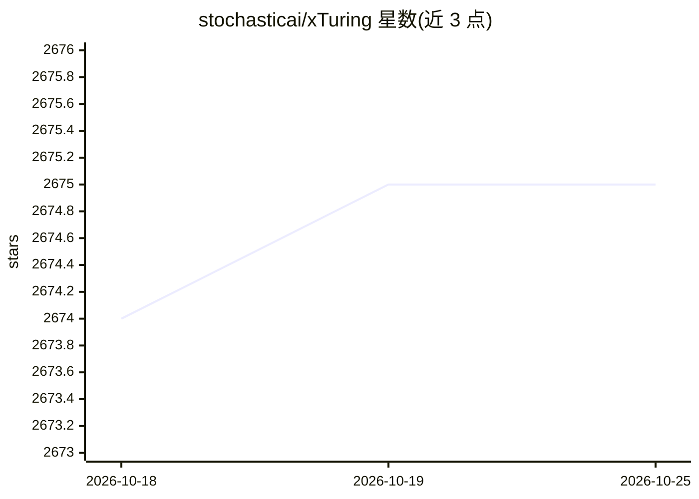

# stochasticai/xTuring

⭐ 2,675 · Python · Apache-2.0 · 推送 2026-10-21 · [GitHub](https://github.com/stochasticai/xTuring) · [官网](https://xturing.stochastic.ai) · 组织维护

**开源 LLM 微调/评测/推理库，本地或私有云个性化模型**

由 Stochastic.ai 维护的 Python 库，提供数据准备、指令微调、评测与推理的高层 API，支持 LLaMA/LLaMA2、GPT-OSS、Qwen3、GPT-J、GPT-2、Mistral、Mamba 等模型，并通过 LoRA、INT8、INT4 低精度方式降低资源消耗，可从 CPU/笔记本扩展到多 GPU（含 DeepSpeed 集成）。内置困惑度评测、CLI/UI 对话、xTuring hub 检查点加载与自指令数据集生成。限制：依赖 transformers>=4.36.0 且暂不兼容 5.x，Qwen3-Omni 支持未发布。面向在自有环境微调开源 LLM 的开发者。

## 筛选速览

| 维度 | 判定 | 备注 |
|---|---|---|
| AI 角色 | `ai-ecosystem` | LLM/agent 周边工具 |
| 许可风险 | `permissive` | Apache-2.0 |
| 部署形态 | `library` | 以包/库形式分发 |
| 模型依赖 | — | README 未给出锁定关系 |
| 硬件要求 | — | 无带数字的原话,不猜 |
| 安装摩擦 | `low` | 无编译、无系统依赖或容器化 |
| 成熟度 | — | 结构信号不足 |

## 能力要点

- LoRA/INT8/INT4 低精度微调与 DeepSpeed 集成，CPU 到多 GPU 均可运行
- 支持 LLaMA、GPT-OSS、Qwen3、GPT-J、GPT-2、Mistral、Mamba 等模型家族
- 内置困惑度评测、CLI chat 与 UI playground
- 自指令数据集生成与 xTuring hub 预微调检查点

## 适用场景

- 用自己的指令数据在本地或私有云微调开源 LLM
- 以低精度方式在有限显存/内存下微调与推理
- 微调后评测困惑度并与社区分享检查点

## 场景标签

`微调` `模型评测` `推理引擎` · 领域:评测与运维

## 证据(README 行号)

> L4:  Fine‑tune, evaluate, and run private, personalized LLMs
> L19: - Simple API for data prep, training, and inference

## 星数曲线

2026-10-18 2,674 → 2026-10-25 2,675（+1）

---
*卡片 v1 · prompt 1.4 · 生成 2026-10-21 · 置信度 high · 依据 README sha `04de6e54fc86` · [字段定义](../../DATASET.md)*
