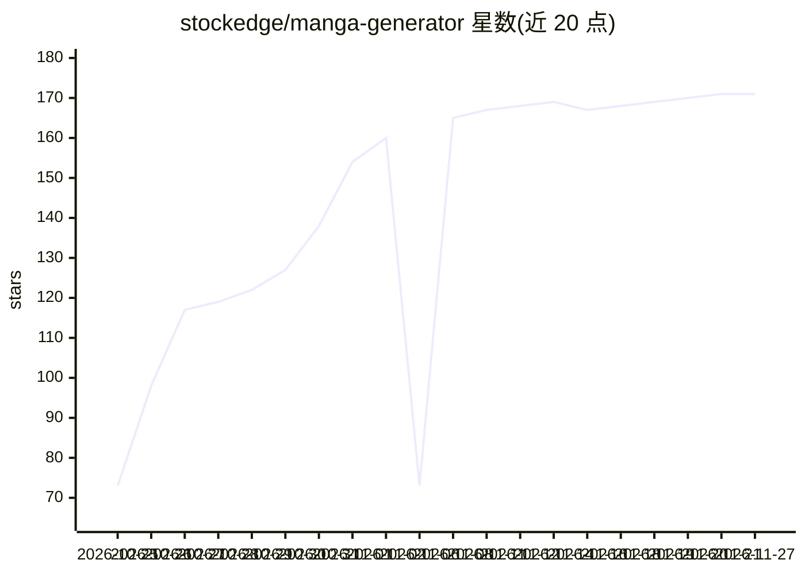

# stockedge/manga-generator

⭐ 171 · JavaScript · MIT · 推送 2026-11-17 · [GitHub](https://github.com/stockedge/manga-generator) · 个人维护

**与 Codex 协作、从原作文本生成漫画到 PDF 的制作工具**

面向漫画创作者的制作工具：以小说或文章原作为输入，在 Codex 代理驱动下推进脚本、分镜（ネーム）、图像生成、文字排版、检品到 PDF 输出的完整流程。台词与气泡和画面分层配置，便于后期修改台词。制作分 quality 与 economy 两种模式，后者限制资料引用、使用独立评审与较短输出。支持 Claude Code 作为替代代理，图像生成依赖外部 ComfyUI 且需另行准备 GPU 环境；制作历史以 gzip 压缩保存以控制容量。

## 筛选速览

| 维度 | 判定 | 备注 |
|---|---|---|
| AI 角色 | `ai-native` | 本体是模型或模型工具 |
| 许可风险 | `permissive` | MIT |
| 部署形态 | `library` | 以包/库形式分发 |
| 模型依赖 | — | README 未给出锁定关系 |
| 硬件要求 | — | 无带数字的原话,不猜 |
| 安装摩擦 | `low` | 无编译、无系统依赖或容器化 |
| 成熟度 | — | 结构信号不足 |

## 能力要点

- 原作文本到脚本、分镜、图像生成、排版、PDF 的全流程制作
- 台词与气泡同画面分离配置，便于后期改台词
- quality/economy 双制作模式，含 seal/reopen 与独立评审机制
- 提供 .agents/skills/ 下的制作、评审、作画技能，兼容 Claude Code/Cursor 自动识别

## 适用场景

- 把自己的小说或文章自动漫画化并导出 PDF
- 用节约模式控制代理调用成本地推进制作
- 在 Claude Code 或 Cursor 中加载技能辅助漫画制作

## 场景标签

`图像生成` · 领域:内容生成

## 证据(README 行号)

> L5: 小説や文章の原作から、脚本・ネーム・画像生成・文字入れ・検品・PDF出力までをCodexと進める漫画制作ツールです。
> L38: 最後まで自動で制作するには、お使いのCodex環境で**画像生成・画像の視覚確認・サブエージェントレビュー**が利用できる必要があります。利用枠やツールが不足した場合は、途中の状態を保存して問題を報告します。
> L69: Claude Code向け導入・制作手順とComfyUI構築手順を用意しています。画像生成は外部ComfyUI、視覚確認と独立レビューはClaude Code、組版・PDF・履歴・再現は共通CLIが担当します。GPU環境は別途必要

## 星数曲线

2026-10-25 73 → 2026-11-27 171（+98）

---
*卡片 v1 · prompt 1.4 · 生成 2026-11-26 · 置信度 high · 依据 README sha `f1b10753c634` · [字段定义](../../DATASET.md)*
