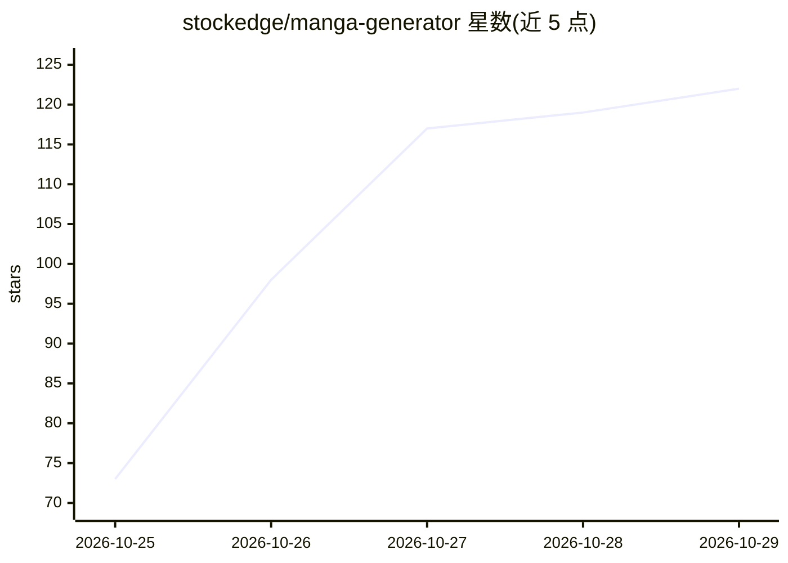

# stockedge/manga-generator

⭐ 122 · JavaScript · MIT · 推送 2026-10-26 · [GitHub](https://github.com/stockedge/manga-generator) · 个人维护

**用 Codex/Claude Code 从小说原作自动制作漫画的工具**

面向使用 Codex 或 Claude Code 的创作者：将小説或文本原作交由 AI agent 完成 脚本、ネーム（分镜）、图像生成、对白排版、检品到 PDF 输出的全流程。文字与气泡和图像分离配置，便于事后修改台词。最终自动制作要求 Codex 环境支持图像生成、视觉确认与子代理评审；Claude Code 路径中图像生成由外部 ComfyUI 承担，需另行准备 GPU 环境。MIT 许可。

## 筛选速览

| 维度 | 判定 | 备注 |
|---|---|---|
| AI 角色 | `ai-native` | 本体是模型或模型工具 |
| 许可风险 | `permissive` | MIT |
| 部署形态 | `None` |  |
| 模型依赖 | — | README 未给出锁定关系 |
| 硬件要求 | — | 无带数字的原话,不猜 |
| 安装摩擦 | `low` | 无编译、无系统依赖或容器化 |
| 成熟度 | — | 结构信号不足 |

## 能力要点

- 从原作文本到 PDF 成稿的全流程漫画制作管线
- 文字/气泡与图像分离配置，台词可事后修改
- 提供 Codex 与 Claude Code（+ComfyUI）两种使用路径
- 准备与命令操作可交由 Codex 自动完成

## 适用场景

- 把自己写的小说自动转化为漫画成品
- 在台词修改后仅重排文字而不重生成图像
- 借助 ComfyUI 用自有图像生成模型制作漫画

## 场景标签

`图像生成` · 领域:内容生成

## 证据(README 行号)

> L5: 小説や文章の原作から、脚本・ネーム・画像生成・文字入れ・検品・PDF出力までをCodexと進める漫画制作ツールです。
> L51: Claude Code向け導入・制作手順とComfyUI構築手順を用意しています。画像生成は外部ComfyUI、視覚確認と独立レビューはClaude Code、組版・PDF・履歴・再現は共通CLIが担当します。GPU環境は別途必要

## 星数曲线

2026-10-25 73 → 2026-10-29 122（+49）

---
*卡片 v1 · prompt 1.4 · 生成 2026-10-24 · 置信度 high · 依据 README sha `e9c01c4d4a34` · [字段定义](../../DATASET.md)*
