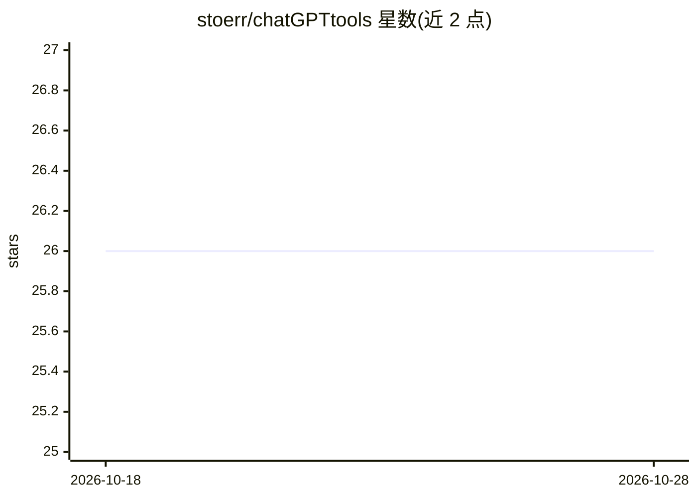

# stoerr/chatGPTtools

⭐ 26 · JavaScript · Apache-2.0 · 推送 2026-10-24 · [GitHub](https://github.com/stoerr/chatGPTtools) · [官网](https://chatgpttools.stoerr.net/) · 个人维护

**个人维护的 ChatGPT 命令行脚本、bookmarklet 与网页工具集合**

围绕 OpenAI ChatGPT API 的工具集合：bin/ 下约 20 余个命令行脚本，主脚本 chatgpt 从命令行访问 chat completion API 并管理会话状态，衍生脚本覆盖摘要文件/网页、语音转录、TTS、DALL-E 3 生图、嵌入生成、修改文件、建议命令行等；另有网页书签（网页摘要、元素提取、Whisper 听写）。主脚本通过 -api 参数可访问 LM Studio、Ollama、Gemini、Claude 等 OpenAI 兼容端点。作者声明为业余项目、无保证，部分新功能标记为不稳定，网页版部署在 GitHub Pages。

## 筛选速览

| 维度 | 判定 | 备注 |
|---|---|---|
| AI 角色 | `ai-native` | 本体是模型或模型工具 |
| 许可风险 | `permissive` | Apache-2.0 |
| 部署形态 | `None` |  |
| 模型依赖 | local-ok | 支持本地模型 |
| 硬件要求 | — | 无带数字的原话,不猜 |
| 安装摩擦 | `low` | 无编译、无系统依赖或容器化 |
| 成熟度 | `idea` | |

## 能力要点

- 约 20 余个命令行脚本：摘要、转录、TTS、生图、嵌入、文件修改等
- chatgpt 主脚本支持会话状态管理与多种输入输出格式
- 通过 -api 参数接入 LM Studio / Ollama / Gemini / Claude 的 OpenAI 兼容端点
- 网页与 bookmarklet 工具：网页摘要、元素提取、Whisper 听写

## 适用场景

- 在命令行中快速向 ChatGPT 提问、摘要文件或网页
- 用本地模型运行器（Ollama / LM Studio）替代 OpenAI 后端跑这些脚本
- 开发者日常工作中做语音转录、代码块提取与文件修改

## 场景标签

`语音合成` `语音识别` `图像生成` `AI 写作` · 领域:内容生成

## 证据(README 行号)

> L58: There is a couple of scripts in bin/ which you might like. The main script is chatgpt , which allows to access
> L66:  - chatgpt Submits prompts for processing and manages conversation states, allowing for various input formats and r

## 星数曲线

2026-10-18 26 → 2026-10-28 26（+0）

---
*卡片 v1 · prompt 1.4 · 生成 2026-10-26 · 置信度 high · 依据 README sha `085a5d39f9d0` · [字段定义](../../DATASET.md)*
