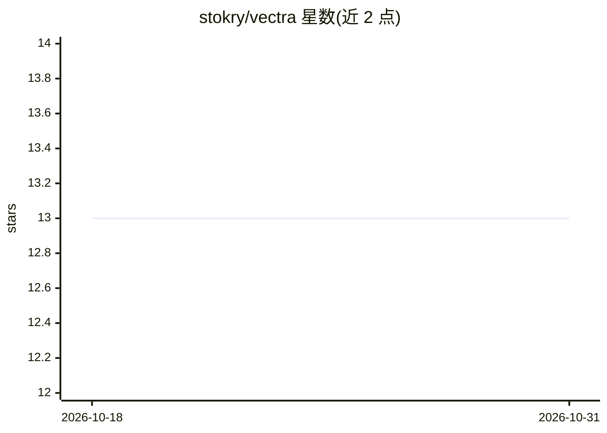

# stokry/vectra

⭐ 13 · Ruby · MIT · 推送 2026-01-28 · [GitHub](https://github.com/stokry/vectra) · [官网](https://vectra-docs.netlify.app/) · 个人维护

**统一 Ruby 向量数据库客户端：一次编写，多后端切换**

面向 Ruby/Rails 开发者的向量数据库统一客户端库，以 gem（vectra-client）发布。支持 Pinecone、Qdrant、Weaviate、pgvector 四种后端及内存测试后端，提供统一 API 的 upsert/查询/混合检索。内置中间件系统（重试、限流、PII 脱敏、成本追踪等）与 7 种生产模式（熔断、连接池、缓存、健康检查），并通过 ActiveRecord 集成、Rails 生成器与向量迁移工具降低接入成本。要求 Ruby 3.2+。

## 筛选速览

| 维度 | 判定 | 备注 |
|---|---|---|
| AI 角色 | `ai-ecosystem` | LLM/agent 周边工具 |
| 许可风险 | `permissive` | MIT |
| 部署形态 | `None` |  |
| 模型依赖 | — | README 未给出锁定关系 |
| 硬件要求 | — | 无带数字的原话,不猜 |
| 安装摩擦 | `low` | 无编译、无系统依赖或容器化 |
| 成熟度 | — | 结构信号不足 |

## 能力要点

- 统一 API 覆盖 Pinecone/Qdrant/Weaviate/pgvector 四种后端
- Rack 风格中间件系统（Logging/Retry/PIIRedaction/CostTracker 等 7 种内置）
- ActiveRecord `has_vector` DSL 与 `rails generate vectra:index` 生成器
- 向量跨后端迁移工具与混合检索（语义+关键词）

## 适用场景

- Rails 应用为模型添加向量检索与语义搜索
- 在不同向量数据库后端之间迁移而无需重写业务代码
- 构建 RAG 聊天机器人时做上下文检索
- 多租户 SaaS 中按命名空间隔离向量数据

## 场景标签

`向量数据库` `语义搜索` · 领域:知识与检索

## 证据(README 行号)

> L18:  A unified Ruby client for vector databases.
> L25: |Provider|Type|Status|
> L72: - **🔌 Provider Agnostic** - Switch between 5 providers with one line change

## 星数曲线

2026-10-18 13 → 2026-10-31 13（+0）

---
*卡片 v1 · prompt 1.4 · 生成 2026-10-31 · 置信度 high · 依据 README sha `766cf74ab1d6` · [字段定义](../../DATASET.md)*
