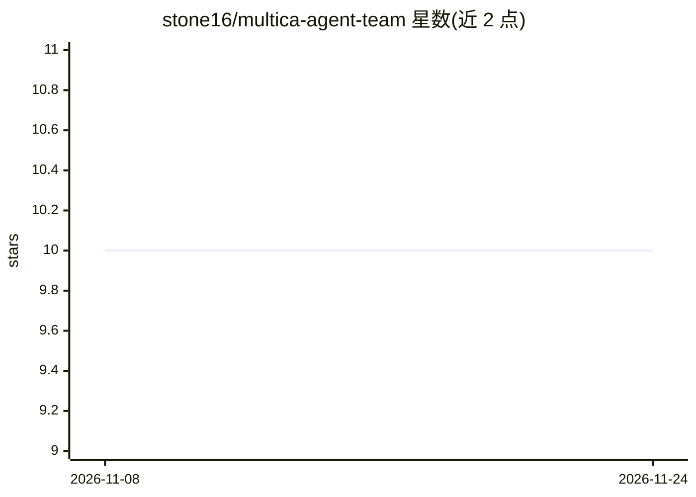

# stone16/multica-agent-team

⭐ 10 · Shell · Apache-2.0 · 推送 2026-09-15 · [GitHub](https://github.com/stone16/multica-agent-team) · [官网](https://github.com/stone16/multica-agent-team#multica-agent-team) · 个人维护 · 中文 README

**为在 Multica 上组织多 Agent 团队提供可复用参考模型**

一个公开的 Git 事实源仓库，定义多 Agent 协作的操作模型：七个 Profession Profile（角色职责与证据契约）、九个 Agent Instance 部署意图、五个持久化 Squad（Discovery/Experience/Delivery/Growth/Reliability）。核心机制是稳定契约进 Git、部署身份与运行上下文可变；每次 Issue Run 由 Orchestrator 选择最小角色集合并定义 DoD，交付物需逐项提供证据并经独立验证或人工确认。附同步脚本（默认 dry-run）、PR 模板与测试。面向使用 Multica 组织 AI Agent 团队的开发者与团队。

## 筛选速览

| 维度 | 判定 | 备注 |
|---|---|---|
| AI 角色 | `ai-ecosystem` | LLM/agent 周边工具 |
| 许可风险 | `permissive` | Apache-2.0 |
| 部署形态 | `None` |  |
| 模型依赖 | — | README 未给出锁定关系 |
| 硬件要求 | — | 无带数字的原话,不猜 |
| 安装摩擦 | `low` | 无编译、无系统依赖或容器化 |
| 成熟度 | — | 结构信号不足 |

## 能力要点

- 七个专业角色与五个持久化 Squad 的稳定契约定义
- Issue-scoped Run 流程：最小角色委派 + DoD + 证据逐项提供
- 非破坏式拓扑与内容同步桥接脚本（默认 dry-run）
- Project ledger 沉淀经审阅的事实、决策与交付物

## 适用场景

- 在 Multica 上搭建按专业分工的多 Agent 协作团队
- 为 Agent 团队制定角色职责边界与验收标准模板
- 用证据驱动的验证流程管理 AI 任务的交接与风险记录

## 场景标签

`多智能体` · 领域:Agent 开发

## 证据(README 行号)

> L17: Multica Agent Team 是一个公开的、可复用的 Agent 公司 Git 事实源，核心关键词是 Multica、AI agents、multi-agent systems 和 agent orchestration。
> L46: DoD 至少包含：可观察的结果、所需证据、验证方式和返工上限。确定性的路由、重试、校验、计数、排序和状态转换交给代码；有歧义的拆解、研究、设计、综合和评估交给模型判断。

## 星数曲线

2026-11-08 10 → 2026-11-24 10（+0）

---
*卡片 v1 · prompt 1.4 · 生成 2026-11-19 · 置信度 mid · 依据 README sha `85204d6de2e5` · [字段定义](../../DATASET.md)*
