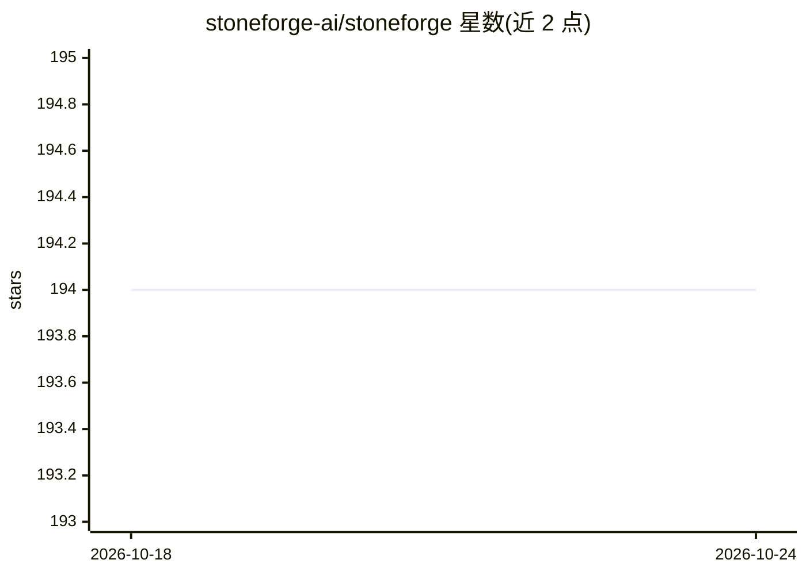

# stoneforge-ai/stoneforge

⭐ 196 · TypeScript · Apache-2.0 · 推送 2026-05-05 · [GitHub](https://github.com/stoneforge-ai/stoneforge) · [官网](https://stoneforge.ai) · 组织维护

**编排多个 AI 编码 agent 的 Web 仪表盘与运行时**

面向已在并行运行多个 AI 编码 agent 的开发者的多 agent 编排平台：Director 规划任务、Worker 在隔离 git worktree 中执行、Steward 自动合并与善后、调度守护进程按优先级分配任务；提供 Web 仪表盘（实时输出、看板、合并请求、指标）与事件溯源的持久化状态。agent 底层可选 Claude Code（默认）、OpenCode 或 OpenAI Codex。README 自述为早期实验性软件，token 消耗高，agent 以跳过权限确认的方式自主运行。

## 筛选速览

| 维度 | 判定 | 备注 |
|---|---|---|
| AI 角色 | `ai-ecosystem` | LLM/agent 周边工具 |
| 许可风险 | `permissive` | Apache-2.0 |
| 部署形态 | `library` | 以包/库形式分发 |
| 模型依赖 | — | README 未给出锁定关系 |
| 硬件要求 | — | 无带数字的原话,不猜 |
| 安装摩擦 | `low` | 无编译、无系统依赖或容器化 |
| 成熟度 | `idea` | |

## 能力要点

- Director/Worker/Steward 角色分工与调度守护进程
- 每个 Worker 在独立 git worktree 中执行，自动合并审查（跑测试通过后 squash-merge）
- 事件溯源状态（SQLite + JSONL），重启后保留完整审计轨迹
- Web 仪表盘：实时终端输出、看板、频道消息、文档库、工作流

## 适用场景

- 并行协调 3–5 个 AI 编码 agent 完成一个功能开发
- 用看板和合并请求队列跟踪 agent 产出
- 以可恢复工作流串起构建→测试→部署流程

## 场景标签

`Agent 框架` `多智能体` `编码 Agent` · 领域:Agent 开发

## 证据(README 行号)

> L5:  A web dashboard and runtime for orchestrating AI coding agents
> L45: Stoneforge is a multi-agent orchestration platform that solves these problems. Install it, start the server, and us
> L105: Agents can use **Claude Code** (default), **OpenCode**, or **OpenAI Codex** as their underlying provider — set via

## 星数曲线

2026-10-18 194 → 2026-10-24 194（+0）

---
*卡片 v1 · prompt 1.4 · 生成 2026-10-22 · 置信度 high · 依据 README sha `888012194dee` · [字段定义](../../DATASET.md)*
