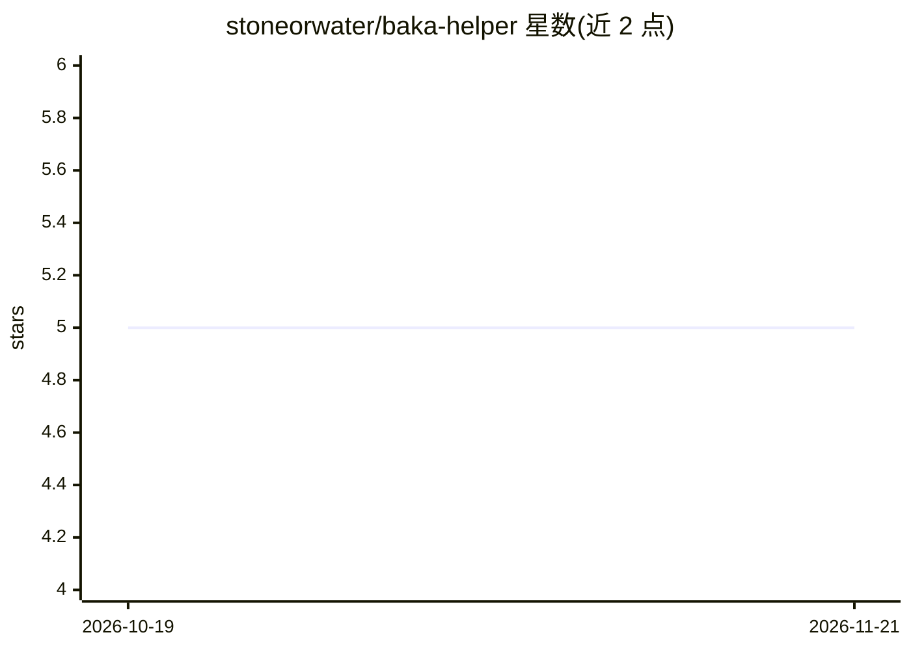

# stoneorwater/baka-helper

⭐ 5 · JavaScript · MIT · 推送 2026-10-11 · [GitHub](https://github.com/stoneorwater/baka-helper) · [官网](https://github.com/stoneorwater/baka-helper/blob/main/docs/USAGE.md) · 个人维护 · 中文 README

**学习通课程辅助用户脚本：视频续播与 AI 答题**

运行在 Tampermonkey 中的浏览器用户脚本，将课程导航、视频续播、阅读辅助、可配置 AI 接口与本地正确答案题库集中在可拖动悬浮面板中。用户自行填写 API Key 调用 OpenAI、DeepSeek、硅基流动、Gemini、Claude 等接口完成文字或截图识题与填写，支持填前校验、多选复核、题库导出导入与去重合并。适配桌面端学习通页面，网页改版和浏览器休眠可能影响运行。

## 筛选速览

| 维度 | 判定 | 备注 |
|---|---|---|
| AI 角色 | `ai-native` | 本体是模型或模型工具 |
| 许可风险 | `permissive` | MIT |
| 部署形态 | `None` |  |
| 模型依赖 | — | README 未给出锁定关系 |
| 硬件要求 | — | 无带数字的原话,不猜 |
| 安装摩擦 | `low` | 无编译、无系统依赖或容器化 |
| 成熟度 | — | 结构信号不足 |

## 能力要点

- 支持 OpenAI、DeepSeek、硅基流动、Gemini、Claude 与自定义兼容接口，手动配置模型 ID
- 本地正确答案题库：收集公布答案或逐题判对的作答，支持导出导入与冲突保留
- 独立顺序收集模式不需 API，仅遍历不填写提交
- 异常恢复机制：无进展超时重试、返回课程与跳过记录

## 适用场景

- 自动定位并续播学习通课程未完成视频
- 配置自有 API Key 用 AI 辅助填写课程习题
- 在多台电脑间迁移复用本地答案题库

## 场景标签

`浏览器自动化` · 领域:效率与自动化

## 证据(README 行号)

> L11: Baka助手是运行在 Tampermonkey 中的浏览器用户脚本，将课程导航、视频与阅读辅助、可配置 AI 接口和答案题库集中在可拖动的琪露诺悬浮面板中。适配以桌面端学习通页面为主，网页改版和浏览器休眠可能影响运行。
> L19: |答题辅助|文字或截图识题、填写前校验、多选复核、可选自动提交；不确定答案记录待处理|

## 星数曲线

2026-10-19 5 → 2026-11-21 5（+0）

---
*卡片 v1 · prompt 1.4 · 生成 2026-11-21 · 置信度 high · 依据 README sha `52348d7f6a88` · [字段定义](../../DATASET.md)*
