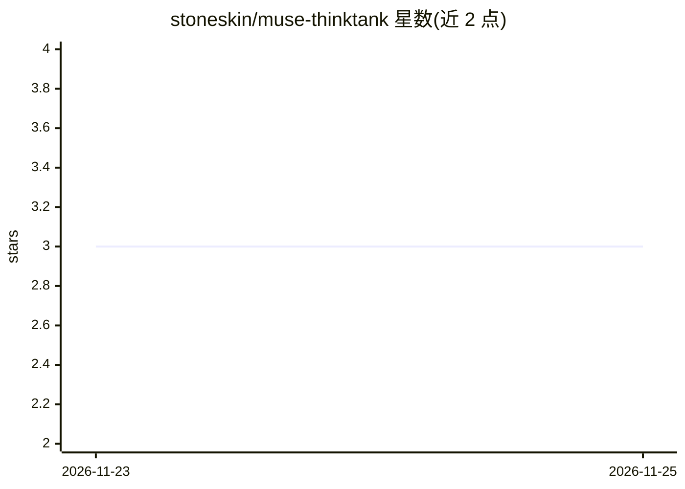

# stoneskin/muse-thinktank

⭐ 3 · Python · Apache-2.0 · 推送 2026-11-11 · [GitHub](https://github.com/stoneskin/muse-thinktank) · [官网](https://github.com/stoneskin/muse-thinktank#readme) · 个人维护 · 中文 README

**多模型辩论编排 CLI：一次提问多模型交叉验证出结论**

面向 Muse 用户的 Python CLI 编排器：一个提示并行发给 N 个模型组成评审团，双评委交叉验证，synth 合并输出裁决；评委分歧自动升级人工复核。纯标准库实现（urllib/json/argparse），零依赖，当前经由 OpenRouter 调用模型。支持成本预估（--estimate）、实时数据注入（--context-data）、按历史成功率与延迟动态筛选成员、red-team 模式等。

## 筛选速览

| 维度 | 判定 | 备注 |
|---|---|---|
| AI 角色 | `ai-ecosystem` | LLM/agent 周边工具 |
| 许可风险 | `permissive` | Apache-2.0 |
| 部署形态 | `None` |  |
| 模型依赖 | locked-api |  |
| 硬件要求 | — | 无带数字的原话,不猜 |
| 安装摩擦 | `low` | 无编译、无系统依赖或容器化 |
| 成熟度 | `idea` | |

## 能力要点

- panel → 双评委交叉验证 → synth 合并的多模型流程
- 成本预估 --estimate 输出调用数、token 上限与 ETA
- 实时数据注入 --context-data 与 PR diff 代码评审模式
- 纯 Python 标准库，零依赖

## 适用场景

- 对时效性问题注入最新数据做多模型分析
- 对 GitHub PR 发起多模型代码评审
- 用多模型交叉验证降低单一模型出错风险

## 场景标签

`多智能体` `代码审查` · 领域:Agent 开发

## 证据(README 行号)

> L9: **Built for Muse users.** A multi-model deliberation orchestrator: one question goes to N models in parallel (panel)
> L11: **Model providers:** OpenRouter today; more carriers planned (see Roadmap).
> L54: One entry point: `thinktank.py` + `tt/` package (stdlib only: `urllib` + `json` + `argparse`).

## 星数曲线

2026-11-23 3 → 2026-11-25 3（+0）

---
*卡片 v1 · prompt 1.4 · 生成 2026-11-23 · 置信度 high · 依据 README sha `6c4135b5e928` · [字段定义](../../DATASET.md)*
