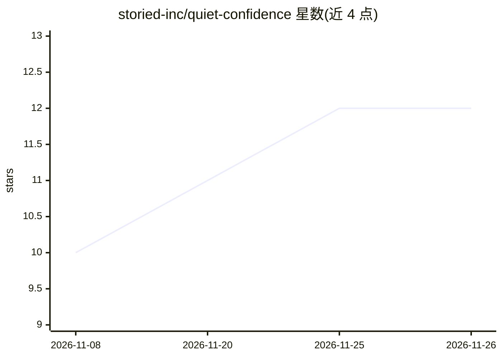

# storied-inc/quiet-confidence

⭐ 12 · CC-BY-4.0 · 推送 2026-10-15 · [GitHub](https://github.com/storied-inc/quiet-confidence) · [官网](https://www.storiedinc.com/storied-ai) · 组织维护

**高风险沟通的语气重写系统：以资本配置者口吻改写职场文书**

一套以提示词/技能文件形式分发的写作风格系统（voice register），将用户已有草稿改写为

## 筛选速览

| 维度 | 判定 | 备注 |
|---|---|---|
| AI 角色 | `ai-native` | 本体是模型或模型工具 |
| 许可风险 | `viral` | CC-BY-4.0 |
| 部署形态 | `None` |  |
| 模型依赖 | — | README 未给出锁定关系 |
| 硬件要求 | — | 无带数字的原话,不猜 |
| 安装摩擦 | `low` | 无编译、无系统依赖或容器化 |
| 成熟度 | — | 结构信号不足 |

## 能力要点

- 以提示词/文件形式分发，可在 Claude、ChatGPT 等任意模型中运行（README 声明）
- 输出包含改写稿与逐条改动说明（引用编号化原则）
- 七条编号化原则与两条测试构成命名标准，避免模型默认输出风格
- 提供粘贴提示词、Claude skill 文件、自建 GPT 三种运行路径

## 适用场景

- 向上级提交策略文档或决策备忘录前重写语气
- 融资路演与投资人更新邮件的措辞调整
- 谈判与销售提案邮件的立场表达
- 跨团队协作中对等沟通的措辞规范

## 场景标签

`AI 写作` `提示工程` · 领域:Agent 开发

## 证据(README 行号)

> L3: **Quiet Confidence is a voice register for high-stakes communication.** It runs in Claude, ChatGPT, and any model. I
> L121: **Two names, and only two.** Say **Quiet Confidence** or **GP register** and the tool fires. Every other term on t

## 星数曲线

2026-11-08 10 → 2026-11-26 12（+2）

---
*卡片 v1 · prompt 1.4 · 生成 2026-11-19 · 置信度 high · 依据 README sha `19bd56db2936` · [字段定义](../../DATASET.md)*
