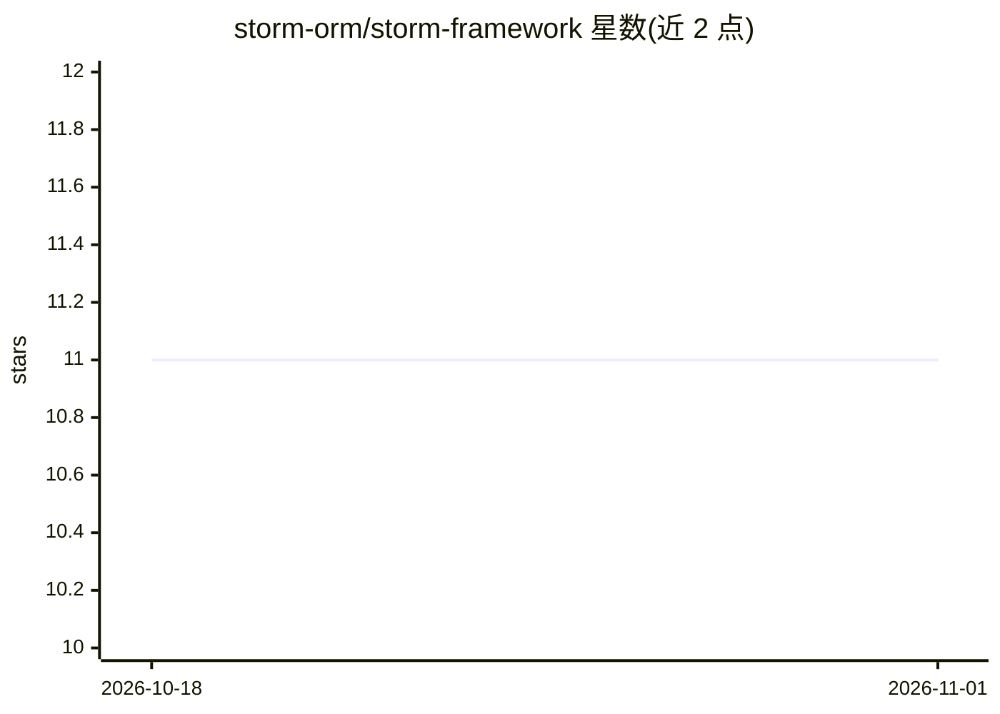

# storm-orm/storm-framework

⭐ 11 · Java · Apache-2.0 · 推送 2026-10-30 · [GitHub](https://github.com/storm-orm/storm-framework) · [官网](https://orm.st) · 组织维护

**面向 Kotlin/Java 的类型安全 SQL-first ORM，支持编码 Agent 集成**

面向 Kotlin 2.0+ 与 Java 21 的 ORM 框架：以不可变 data class 实体与编译期元模型（User_/City_）提供类型安全 DSL，实体图单查询加载，无代理、无持久化上下文，无 N+1。模块化设计，通过 Gradle 插件或 BOM + Maven/Gradle 安装，提供 PostgreSQL/MySQL/Oracle/SQL Server/SQLite/H2 等 JDBC 方言。针对编码 Agent 设计：npx @storm-orm/cli init 为 Claude Code、Cursor、GitHub Copilot、Windsurf、Codex 安装规则与技能，可选部署只读 MCP server 供 Agent 读取 schema。限制：Java 路径使用 String Templates 预览特性，编译运行锁定在 JDK 21。

## 筛选速览

| 维度 | 判定 | 备注 |
|---|---|---|
| AI 角色 | `ai-enhanced` | 去掉 AI 部分产品仍成立 |
| 许可风险 | `permissive` | Apache-2.0 |
| 部署形态 | `library` | 以包/库形式分发 |
| 模型依赖 | — | README 未给出锁定关系 |
| 硬件要求 | — | 无带数字的原话,不猜 |
| 安装摩擦 | `medium` | 含编译或系统依赖之一 |
| 成熟度 | — | 结构信号不足 |

## 能力要点

- 不可变实体 + 编译期元模型，查询类型错误在编译期暴露
- 实体图单查询加载，无代理/懒加载/持久化上下文
- npx @storm-orm/cli 为多种编码 Agent 安装规则与技能，可选只读 MCP server
- 模块化方言包覆盖 PostgreSQL/MySQL/Oracle/SQL Server/SQLite/H2 等

## 适用场景

- Kotlin/Java 项目替代传统 ORM 做类型安全数据访问
- 让 Claude Code/Cursor 等编码 Agent 直接读懂并操作数据模型
- 从 JPA/Hibernate 迁移到 SQL-first 的映射方案

## 场景标签

 · 领域:软件开发/数据访问

## 证据(README 行号)

> L11: **Storm is the type-safe, SQL-first ORM for Kotlin 2.0+ and Java 21, built for agentic coding and performance.** Im
> L153: It installs Storm's rules and skills for Claude Code, Cursor, GitHub Copilot, Windsurf and Codex. An existing `CLA

## 星数曲线

2026-10-18 11 → 2026-11-01 11（+0）

---
*卡片 v1 · prompt 1.4 · 生成 2026-11-01 · 置信度 high · 依据 README sha `d39b74391a4b` · [字段定义](../../DATASET.md)*
