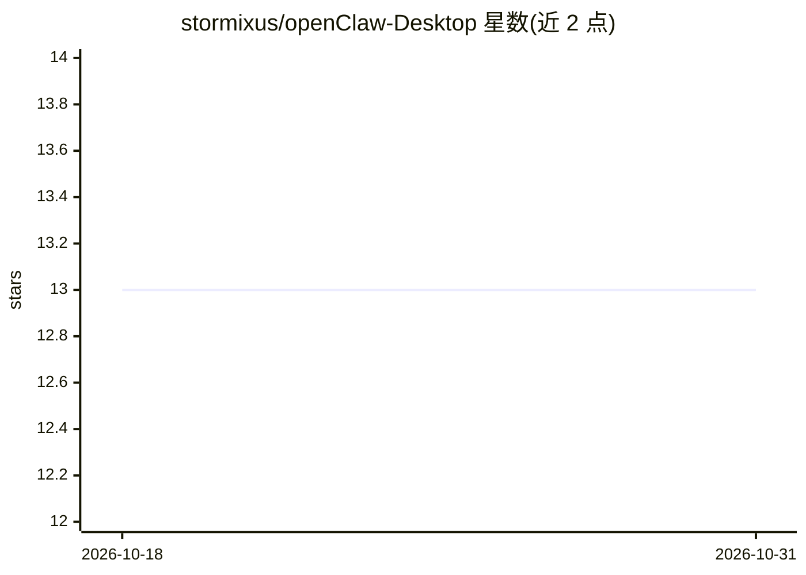

# stormixus/openClaw-Desktop

⭐ 13 · Svelte · MIT · 推送 2026-02-15 · [GitHub](https://github.com/stormixus/openClaw-Desktop) · 个人维护

**本地 AI 桌面应用：多网关聊天、AI 文档协作与 14+ 游戏**

基于 Tauri 2 + SvelteKit + Rust 构建的桌面应用，面向终端用户：多网关 AI 聊天（流式输出、文件上传、模型切换、会话历史）、Forge 文档编辑器（支持 Excel/Word/PDF/PowerPoint/HWP/Markdown/JSON，AI agent 可带审批流程实时协同编辑）、14+ 内置游戏（Chess/Poker/Go-Stop/ 장기 等，可与网关接入的 LLM agent 对战）、带情绪状态与头像表情的 NPC 角色对话模式。支持同时连接多个 openClaw 网关，采用 Ed25519 设备级认证。提供 macOS/Windows/Linux 安装包。界面语言为英语与韩语。

## 筛选速览

| 维度 | 判定 | 备注 |
|---|---|---|
| AI 角色 | `ai-native` | 本体是模型或模型工具 |
| 许可风险 | `permissive` | MIT |
| 部署形态 | `desktop` | 安装包/桌面程序 |
| 模型依赖 | — | README 未给出锁定关系 |
| 硬件要求 | — | 无带数字的原话,不猜 |
| 安装摩擦 | `low` | 无编译、无系统依赖或容器化 |
| 成熟度 | — | 结构信号不足 |

## 能力要点

- 多网关 AI 聊天：流式输出、文件上传、模型切换、会话历史
- Forge 文档编辑器支持 7 种格式，AI agent 带审批流程实时协同编辑
- 14+ 内置游戏，可与经网关接入的 LLM agent 对战
- NPC 模式：情绪状态、动作、动态背景与头像表情

## 适用场景

- 在一个桌面应用里集中使用多个 AI 网关做聊天
- 让 AI agent 协同编辑 Office/PDF 等文档并保留审批流程
- 与 AI agent 下国际象棋、打扑克等游戏
- 进行带情绪表现的角色化 NPC 对话

## 场景标签

`聊天机器人` `AI 写作` · 领域:对话与助手

## 证据(README 行号)

> L5:  AI-native desktop app for chat, documents, and games
> L46: **Chat** &mdash; Multi-gateway AI chat with streaming, file uploads, model switching, and session history.

## 星数曲线

2026-10-18 13 → 2026-10-31 13（+0）

---
*卡片 v1 · prompt 1.4 · 生成 2026-10-31 · 置信度 high · 依据 README sha `7ec47d84b161` · [字段定义](../../DATASET.md)*
