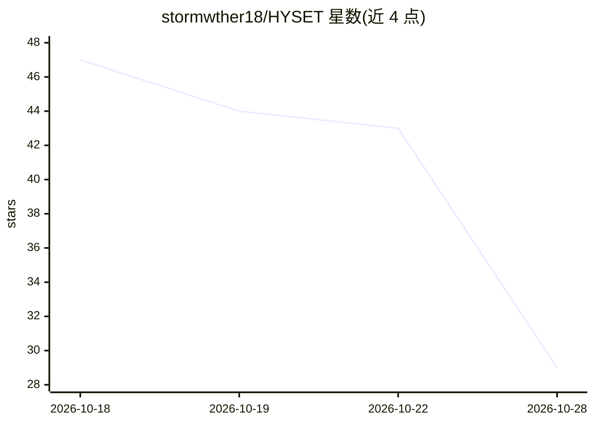

# stormwther18/HYSET

⭐ 29 · Python · MIT · 推送 2026-10-12 · [GitHub](https://github.com/stormwther18/HYSET) · [官网](https://stormwther18-hyset-demo.hf.space) · 个人维护 · 中文 README

**面向 LLM Agent 的工具集合级检索方法：按查询预测超边选出联合可用的工具集**

研究代码仓库，实现论文 Tools Are Not Islands 提出的 HYSET 框架：将 Agent 的工具检索形式化为查询条件下的超边预测，对候选工具集合整体打分（F_set 按集合基数建模工具对交互 + F_align 查询条件注意力），输出变基数预测集合。提供训练、推理与评测脚本，在 ToolBench 六个官方测试切分上报告 Recall/NDCG/COMP 等指标。附带 13,860 工具语料，checkpoint 与查询编码器（ToolGen-Qwen2.5-1.5B）托管在 Hugging Face，原始 ToolBench 数据需自行下载。支持 BERT 与 Qwen 两种编码器配置，提供线上 Demo。

## 筛选速览

| 维度 | 判定 | 备注 |
|---|---|---|
| AI 角色 | `ai-ecosystem` | LLM/agent 周边工具 |
| 许可风险 | `permissive` | MIT |
| 部署形态 | `library` | 以包/库形式分发 |
| 模型依赖 | — | README 未给出锁定关系 |
| 硬件要求 | — | 无带数字的原话,不猜 |
| 安装摩擦 | `medium` | 含编译或系统依赖之一 |
| 成熟度 | — | 结构信号不足 |

## 能力要点

- 将工具检索形式化为查询条件下的超边预测，以候选工具集为打分单元
- F_set 显式建模基数依赖的工具对交互，F_align 为查询条件注意力
- 提供 13,860 工具语料、六个 ToolBench 官方测试切分与训练/推理/评测脚本
- 支持 BERT 与 Qwen 两种编码器配置，checkpoint 托管于 Hugging Face

## 适用场景

- 为拥有数千 API 库的 LLM Agent 做工具预选
- 复现论文在 ToolBench 上的集合级检索实验
- 研究工具共调用模式与集合基数的关系

## 场景标签

 · 领域:自然语言处理/信息检索

## 证据(README 行号)

> L15: Large language model agents increasingly rely on invoking external tools to complete real-world tasks. As tool libr
> L43: `F_set` reads the set as a hyperedge and sums the interaction of every tool pair inside it through a matrix that be

## 星数曲线

2026-10-18 47 → 2026-10-28 29（-18）

---
*卡片 v1 · prompt 1.4 · 生成 2026-10-28 · 置信度 mid · 依据 README sha `740e2a317c61` · [字段定义](../../DATASET.md)*
