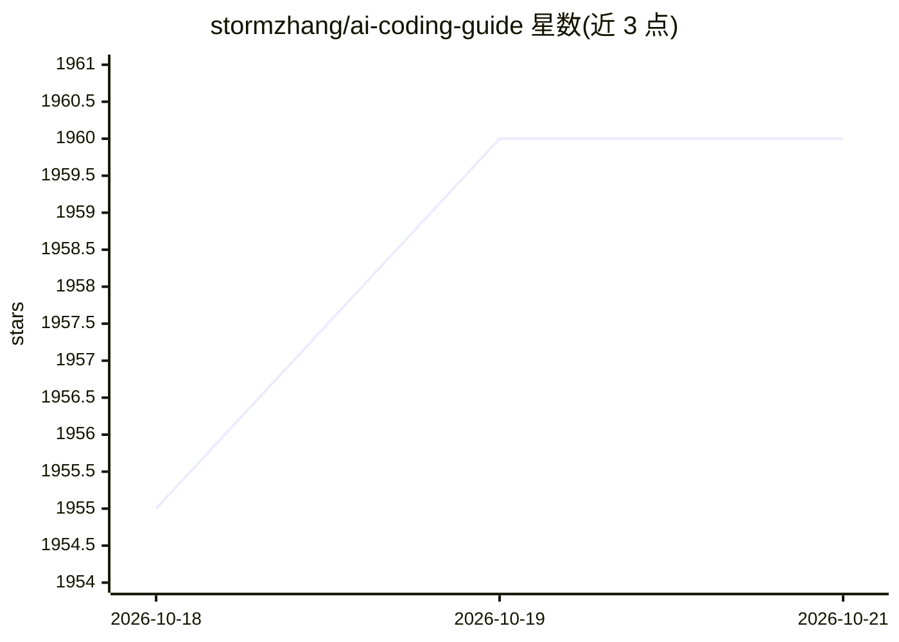

# stormzhang/ai-coding-guide

⭐ — · [GitHub]() · 个人维护 · 中文 README

**面向小白的 AI 编程 CLI 中文教程：Codex 39 篇 + Claude Code 53 篇**

stormzhang 维护的简体中文教程仓库，共 92 篇、约 52 万字，覆盖 Codex（39 篇，主力推荐）与 Claude Code（53 篇）两款 AI 编程 CLI 工具，从安装入门讲到 MCP、子代理、Skills、Hooks、CI/CD 等工程实战。内容以官方文档为事实来源核对，采用场景引入+类比+实例的三段式写法，每篇附可照跑的命令与预期输出，并配 81 张暗色风原创图。教程本身免费（MIT），所涉工具需另行订阅或 API 付费。提供在线阅读站点，92 篇已全部成稿并经四轮审核。

## 筛选速览

| 维度 | 判定 | 备注 |
|---|---|---|
| AI 角色 | `ai-knowledge` | 知识聚合/清单类 |
| 许可风险 | `permissive` | — |
| 部署形态 | `None` |  |
| 模型依赖 | — | README 未给出锁定关系 |
| 硬件要求 | — | 无带数字的原话,不猜 |
| 安装摩擦 | `low` | 无编译、无系统依赖或容器化 |
| 成熟度 | — | 结构信号不足 |

## 能力要点

- 92 篇教程覆盖 Codex 与 Claude Code 两款 CLI 工具全流程
- 所有功能/命令/默认行为对照官方文档核实
- 每篇附可照跑命令与预期输出，含第一人称踩坑记录
- 81 张暗色工程风原创 SVG/PNG 配图

## 适用场景

- 0 基础入门 Codex 或 Claude Code 等 AI 编程 CLI
- 系统学习 MCP、子代理、Skills、Hooks 等进阶用法
- 从 Claude Code 迁移到 Codex 或做横向对比

## 场景标签

`教程课程` · 领域:学习与行业

## 证据(README 行号)

> L5: > 📘 **92 篇 · 约 52 万字** 精修中文教程，主力推荐 **Codex 39 篇**，同时保留 **Claude Code 53 篇**。适合 0 基础学习，从安装入门一直走到工程实战。
> L21: - **以官方文档为事实来源**：所有功能 / 命令 / 默认行为对照 Codex 官方 和 Claude Code 官方 核实，不抄第三方猜测、不靠传言。

## 星数曲线

2026-10-18 1,955 → 2026-10-21 1,960（+5）

---
*卡片 v1 · prompt 1.4 · 生成 2026-10-21 · 置信度 high · 依据 README sha `c15b85d007e6` · [字段定义](../../DATASET.md)*
