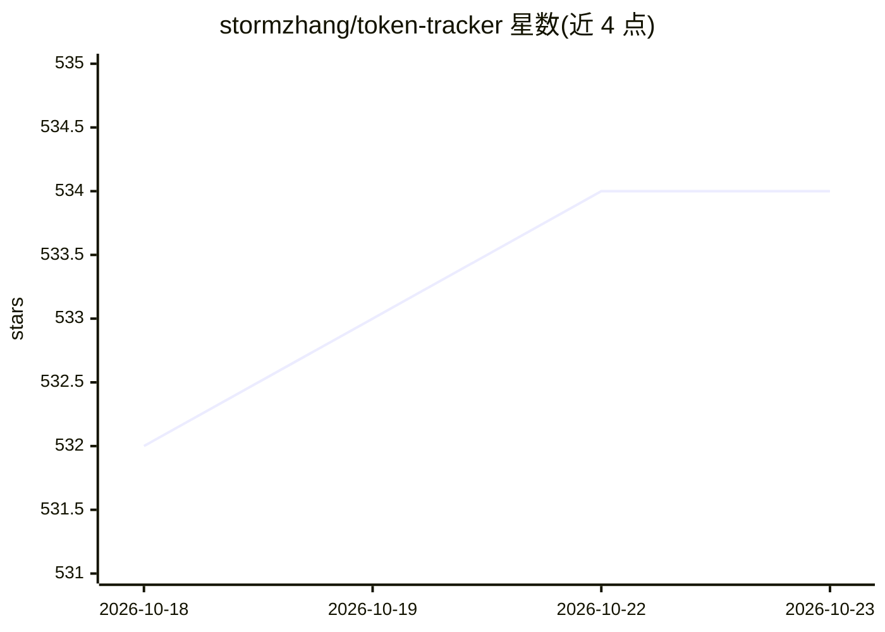

# stormzhang/token-tracker

⭐ 534 · Python · MIT · 推送 2026-10-10 · [GitHub](https://github.com/stormzhang/token-tracker) · 个人维护 · 中文 README

**追踪 Claude Code/Codex/Kimi Code 本地 token 用量的 CLI 工具**

Python 编写的终端工具，只读解析 Claude Code、Codex、Kimi Code 的本地会话记录（JSONL/SQLite），提供状态栏集成（Claude/Kimi 官方接口、Codex 用 Stop hook 伪状态栏）、实时侧边栏、GitHub 风格热力图与日/周/月成本报表。定价识别内置官方价并兼容 LiteLLM 在线定价，覆盖国内外主流模型，数据纯本地存储。需 Python 3.11+，一键脚本安装（uv/pipx/私有 venv 自动选择）。

## 筛选速览

| 维度 | 判定 | 备注 |
|---|---|---|
| AI 角色 | `ai-ecosystem` | LLM/agent 周边工具 |
| 许可风险 | `permissive` | MIT |
| 部署形态 | `library` | 以包/库形式分发 |
| 模型依赖 | locked-api |  |
| 硬件要求 | — | 无带数字的原话,不猜 |
| 安装摩擦 | `low` | 无编译、无系统依赖或容器化 |
| 成熟度 | — | 结构信号不足 |

## 能力要点

- 多 Agent（Claude Code/Codex/Kimi Code）统一只读追踪，按来源分组
- 5h/7d 限额百分比监控 + 重置倒计时
- LiteLLM 在线定价 + 内置官方价双层兜底，含长上下文阶梯价与峰谷价
- tt sidebar 实时侧边栏：活跃会话总览、状态灯、点击跳转 iTerm2/tmux 窗格

## 适用场景

- 我在终端实时查看各 AI Agent 会话的 token 用量与限额状态
- 按项目/模型/周期生成成本报表，分析订阅额度消耗
- 用热力图回顾过去一年的 token 使用分布

## 场景标签

 · 领域:开发者工具/终端应用

## 证据(README 行号)

> L3: 本地 AI Agent Token 消耗追踪/分析工具，支持 **Claude Code**、**Codex** 和 **Kimi Code**。
> L15: - **多 Agent 统一追踪** — Claude Code + Codex + Kimi Code 统一读取，多 Agent 按来源分组
> L223: |Agent|路径|格式|

## 星数曲线

2026-10-18 532 → 2026-10-23 534（+2）

---
*卡片 v1 · prompt 1.4 · 生成 2026-10-21 · 置信度 mid · 依据 README sha `18339e3ceffd` · [字段定义](../../DATASET.md)*
