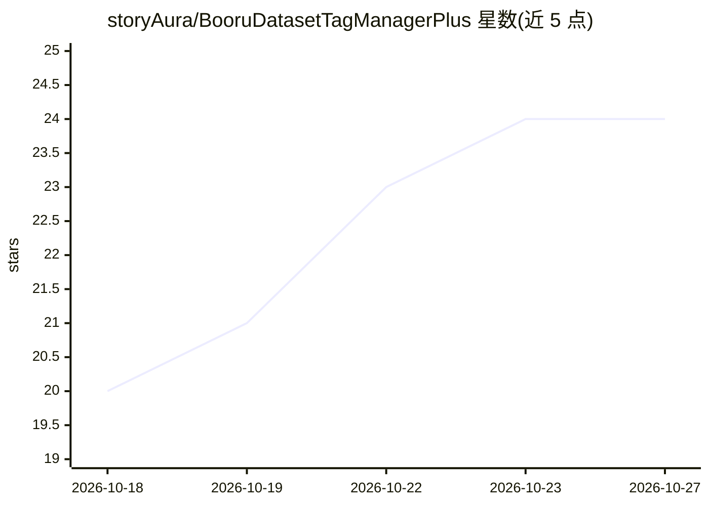

# storyAura/BooruDatasetTagManagerPlus

⭐ 24 · C# · MIT · 推送 2026-10-14 · [GitHub](https://github.com/storyAura/BooruDatasetTagManagerPlus) · 个人维护 · 中文 README

**面向 LoRA/角色数据集的 Windows 打标工具**

单文件 Windows 桌面程序：加载文件夹后按图为单位编辑同名 .txt 标签文件，支持撤销重做、权重、批量修改与 AND/OR/NOT/XOR 筛图。内置约 10 万通用标签与 33 万角色名单的中文搜索；可用本地 ONNX 模型（WD14/PixAI/CL/OppaiOracle）推标、接任意 OpenAI 兼容端点做 LLM 打标、AI 对照标准图审查角色标签（最多 4 角色），并提供图片编辑、裁剪、YOLO 多重切割、预分桶、背景移除与视频抽帧等数据集整理功能。同一 exe 可命令行批量运行。Release 包自带 .NET 运行时，除 LLM 相关功能外均可离线使用。fork 自 starik222/BooruDatasetTagManager。

## 筛选速览

| 维度 | 判定 | 备注 |
|---|---|---|
| AI 角色 | `ai-enhanced` | 去掉 AI 部分产品仍成立 |
| 许可风险 | `permissive` | MIT |
| 部署形态 | `desktop` | 安装包/桌面程序 |
| 模型依赖 | — | README 未给出锁定关系 |
| 硬件要求 | — | 无带数字的原话,不猜 |
| 安装摩擦 | `medium` | 含编译或系统依赖之一 |
| 成熟度 | — | 结构信号不足 |

## 能力要点

- 本地 ONNX 模型推标（WD14/PixAI/CL/OppaiOracle），GPU 或 CPU 运行，图片不出本机
- 任意 OpenAI 兼容端点的 LLM 打标，输出标签或自然语言描述
- AI 角色标签审查：对照标准图删错标/补颜色，最多 4 角色，逐条复核后写入
- 约 10 万通用标签与 33 万角色名单的中文搜索，标签按类别着色

## 适用场景

- 为 LoRA / 角色训练数据集逐图编辑与批量管理标签
- 用本地模型给图片自动推标，或接 LLM 生成描述
- 整理数据集：相似图/坏图扫描、裁剪分桶、背景移除、视频抽帧

## 场景标签

 · 领域:图像数据集标注/Stable Diffusion 生态工具

## 证据(README 行号)

> L11: 每张图配一个同名 `.txt` 存放标签，加载文件夹就能改。也能用本地 Tag 推标或 LLM 自动打标、审查角色标签、用中文搜索 Danbooru 标签。界面默认简体中文。fork 自 starik222/BooruDatase
> L19: - **Tag 推标**：本地 ONNX 模型（WD14 / PixAI / CL / OppaiOracle），GPU 或 CPU 运行，图片不出本机
> L20: - **LLM 打标**：任意 OpenAI 兼容端点，输出标签或自然语言描述

## 星数曲线

2026-10-18 20 → 2026-10-27 24（+4）

---
*卡片 v1 · prompt 1.4 · 生成 2026-10-27 · 置信度 high · 依据 README sha `44b579192f7a` · [字段定义](../../DATASET.md)*
