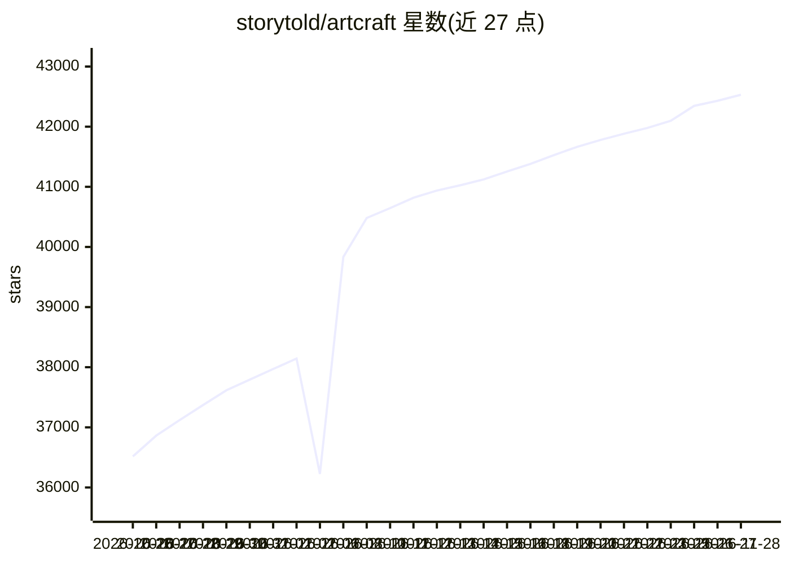

# storytold/artcraft

⭐ 42,531 · Rust · Apache-2.0 · 推送 2026-11-27 · [GitHub](https://github.com/storytold/artcraft) · [官网](https://getartcraft.com) · 组织维护

**面向艺术家/设计师/影视人的 AI 图像与视频创作 IDE**

ArtCraft 是一个桌面端交互式 AI 图像与视频创作 IDE：提供 2D 画布合成、3D 场景搭建、图像转 3D 网格、角色摆姿与身份迁移、背景移除、Kitbashing 场景预排等功能，用可视化工具替代纯提示词以获得可复现的构图控制。内置 62 个模型的目录，覆盖图像、视频、音乐/音效、3D 网格与世界生成（Gaussian splats），支持接入 Grok、Midjourney、Sora、World Labs 等提供商。提供 Windows/macOS/Linux 安装包与源码构建，采用 MIT 或 Apache-2.0 双许可。

## 筛选速览

| 维度 | 判定 | 备注 |
|---|---|---|
| AI 角色 | `ai-native` | 本体是模型或模型工具 |
| 许可风险 | `permissive` | Apache-2.0 |
| 部署形态 | `None` |  |
| 模型依赖 | locked-api |  |
| 硬件要求 | — | 无带数字的原话,不猜 |
| 安装摩擦 | `low` | 无编译、无系统依赖或容器化 |
| 成熟度 | — | 结构信号不足 |

## 动量与使用信号

- 维护:`active` — 距上次 push 3.2 天,年发版 26,3 位贡献者
- 涨星:近 1 天 **+1,822**(自 20261016 起算)

## 能力要点

- 2D 画布与 3D 场景搭建工具：图层合成、图像转 3D 网格、角色摆姿与相机预排
- 内置 62 个模型目录，覆盖图像、视频、音乐音效、3D 网格与世界生成
- 支持 Grok、Midjourney、Sora、World Labs 等多家提供商接入
- 提供 Windows/macOS/Linux 安装包及 AppImage/DEB/RPM/Arch/Flatpak 打包

## 适用场景

- 为影视/设计项目预排 3D 场景后再生成图像与视频
- 用文本提示快速探索图像创意，再用画布与遮罩精修局部
- 将单张图像转为可摆放、旋转、取景的 3D 物体
- 在同一工作流中生成图像、动画、配乐与 3D 资产

## 场景标签

`图像生成` `视频生成` `多模态` · 领域:内容生成

## 证据(README 行号)

> L21: ArtCraft is the IDE for interactive AI image and video creation. Compose in 2D, stage scenes in 3D, and choose the 
> L54: ## Models and Providers Supported within ArtCraft

## 星数曲线

2026-10-26 36,516 → 2026-11-28 42,531（+6,015）

---
*卡片 v1 · prompt 1.4 · 生成 2026-11-22 · 置信度 mid · 依据 README sha `684c3572a2a5` · [字段定义](../../DATASET.md)*
