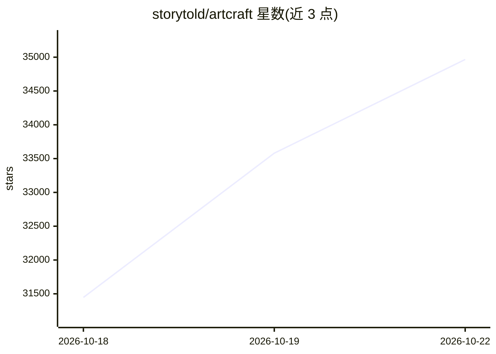

# storytold/artcraft

⭐ 34,966 · Rust · Apache-2.0 · 推送 2026-10-21 · [GitHub](https://github.com/storytold/artcraft) · [官网](https://getartcraft.com) · 组织维护

**面向艺术家与影像创作者的 AI 图像/视频生成 IDE**

ArtCraft 定位为交互式 AI 图像与视频创作的 IDE：支持 2D 合成、3D 场景搭建、角色摆姿、镜头规划等可视化创作工具，并可调用多种模型生成图像、视频、音乐、3D 网格与世界（Gaussian splats），目录共列出 62 个模型。提供 Windows 与 macOS 稳定版下载，也可从源码构建（含 Linux）。部分模型标注为当前禁用或桌面端受限。

## 筛选速览

| 维度 | 判定 | 备注 |
|---|---|---|
| AI 角色 | `ai-native` | 本体是模型或模型工具 |
| 许可风险 | `dual` | Apache-2.0 |
| 部署形态 | `None` |  |
| 模型依赖 | locked-api |  |
| 硬件要求 | — | 无带数字的原话,不猜 |
| 安装摩擦 | `low` | 无编译、无系统依赖或容器化 |
| 成熟度 | — | 结构信号不足 |

## 动量与使用信号

- 维护:`active` — 距上次 push 3.2 天,年发版 26,3 位贡献者
- 涨星:近 1 天 **+1,822**(自 20261016 起算)

## 能力要点

- 2D/3D 场景合成与镜头规划工具（Image to Location、Kitbashing 等）
- 62 模型目录覆盖图像、视频、音乐/音效、3D 网格与世界生成
- 支持 Grok、Midjourney、Sora、World Labs 等模型提供方
- Windows/macOS 稳定版下载，支持从源码构建（含 Linux）

## 适用场景

- 在生成前用 3D 场景工具规划构图、角色身份与机位
- 通过文本提示在多种图像/视频模型间探索创意
- 将图像转为可摆放旋转的 3D 物体或世界场景

## 场景标签

`图像生成` `视频生成` · 领域:内容生成

## 证据(README 行号)

> L17: ArtCraft is the IDE for interactive AI image and video creation. Compose in 2D, stage scenes in 3D, and choose the 
> L50: ## Models and Providers Supported within ArtCraft
> L112: - Stable releases for Windows and macOS

## 星数曲线

2026-10-18 31,446 → 2026-10-22 34,966（+3,520）

---
*卡片 v1 · prompt 1.4 · 生成 2026-10-18 · 置信度 high · 依据 README sha `63d85426fd34` · [字段定义](../../DATASET.md)*
