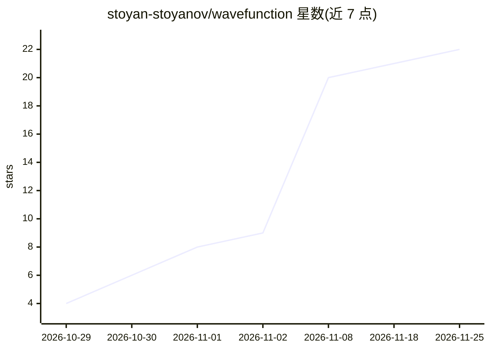

# stoyan-stoyanov/wavefunction

⭐ 22 · Python · MIT · 推送 2026-11-24 · [GitHub](https://github.com/stoyan-stoyanov/wavefunction) · [官网](https://www.wavefunction.si) · 个人维护

**macOS 开源桌面编码 agent：并行会话、MCP 连接器与计算机使用**

面向 macOS 的开源桌面编码 agent（MIT，Tauri+React+Python 引擎）。每个聊天是独立会话，可在 Git worktree 分支上并行工作，支持消息中途转向、子任务 helper、会话分叉与回滚、定时 routine 和上下文自动摘要。计算机使用在本地 Docker 容器的独立桌面中运行，不占用用户鼠标键盘屏幕。提供 70+ 现成连接器与 MCP 服务器接入，兼容 AGENTS.md 与 SKILL.md 技能目录，并内置用量统计（token/成本）。模型可本地运行、自带 API key 或 ChatGPT 登录；需 Apple Silicon、macOS 11+。

## 筛选速览

| 维度 | 判定 | 备注 |
|---|---|---|
| AI 角色 | `ai-native` | 本体是模型或模型工具 |
| 许可风险 | `permissive` | MIT |
| 部署形态 | `None` |  |
| 模型依赖 | — | README 未给出锁定关系 |
| 硬件要求 | — | 无带数字的原话,不猜 |
| 安装摩擦 | `low` | 无编译、无系统依赖或容器化 |
| 成熟度 | — | 结构信号不足 |

## 能力要点

- 并行聊天各自使用独立 Git worktree，互不干扰
- 计算机使用在本地 Docker 容器独立桌面运行，不接管用户输入与屏幕
- 70+ 连接器与任意 MCP 服务器，兼容 AGENTS.md / SKILL.md 技能目录
- 用量统计：token（缓存/非缓存）、运行次数、成本，按模型与日期汇总

## 适用场景

- 在 Mac 上并行开多个编码 agent 会话处理不同任务
- 让 agent 在隔离桌面中操作网页完成浏览器任务
- 通过 MCP 连接器让编码 agent 访问 Gmail、Atlassian 等服务
- 本地模型或自有 API key 下进行私有化编码辅助

## 场景标签

`编码 Agent` `GUI 自动化` `浏览器自动化` · 领域:效率与自动化

## 证据(README 行号)

> L4:  A coding agent for your Mac. Keep talking while it works on several tasks at once.
> L23: Wavefunction has one built-in coding agent. Each chat is a separate conversation with it, with its own model, folde

## 星数曲线

2026-10-29 4 → 2026-11-25 22（+18）

---
*卡片 v1 · prompt 1.4 · 生成 2026-11-18 · 置信度 high · 依据 README sha `a13a0eda620f` · [字段定义](../../DATASET.md)*
