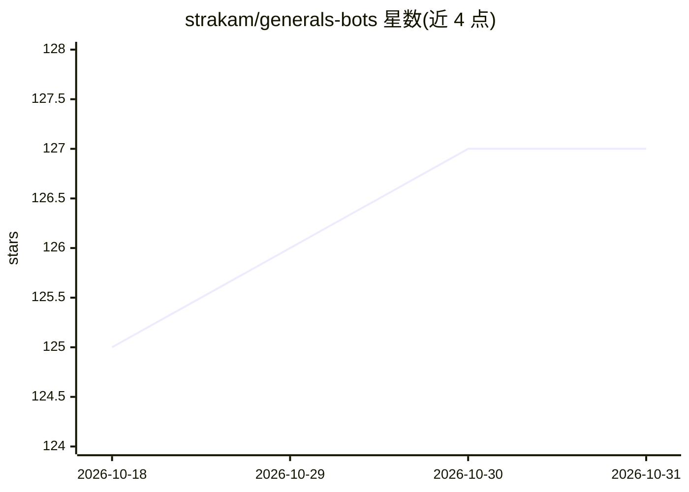

# strakam/generals-bots

⭐ 127 · Python · NOASSERTION · 推送 2026-10-10 · [GitHub](https://github.com/strakam/generals-bots) · 个人维护

**给 RL 研究者的 generals.io 游戏模拟器与 bot 开发平台**

基于 JAX 的 generals.io 游戏模拟器，面向强化学习研究：提供 JIT 编译、可 vmap 向量化并行运行大量对局的 Gymnasium 风格环境，状态不可变、轨迹可复现；支持 1v1、多人混战与组队模式，观测/动作/合法动作掩码均有定义。附 pygame GUI 可视化调试，并可将训练好的 agent 通过 autopilot 部署到 generals.io 官方服务器进行真实对局。安装方式为 git clone 后 pip install -e .。

## 筛选速览

| 维度 | 判定 | 备注 |
|---|---|---|
| AI 角色 | `ai-ecosystem` | LLM/agent 周边工具 |
| 许可风险 | `none` | NOASSERTION |
| 部署形态 | `library` | 以包/库形式分发 |
| 模型依赖 | — | README 未给出锁定关系 |
| 硬件要求 | — | 无带数字的原话,不猜 |
| 安装摩擦 | `low` | 无编译、无系统依赖或容器化 |
| 成熟度 | — | 结构信号不足 |

## 能力要点

- JAX 全 JIT 编译模拟器，vmap 向量化并行运行数千局
- 纯函数式设计：不可变状态、可复现轨迹
- 支持 1v1 / 多人混战 / 组队（共享视野等规则）
- 可部署 agent 到 generals.io 官方服务器（autopilot）

## 适用场景

- 用 JAX/Gymnasium 训练 generals.io 强化学习 bot
- 大规模并行自博弈生成训练数据
- 把训练好的 agent 接入真实在线对局

## 场景标签

`强化学习` · 领域:训练与推理

## 证据(README 行号)

> L9: A high-performance JAX-based simulator for generals.io, designed for reinforcement learning research.
> L27: > The goal is to provide a fast bot development platform for reinforcement learning research.

## 星数曲线

2026-10-18 125 → 2026-10-31 127（+2）

---
*卡片 v1 · prompt 1.4 · 生成 2026-10-23 · 置信度 mid · 依据 README sha `90b05b9cccf8` · [字段定义](../../DATASET.md)*
