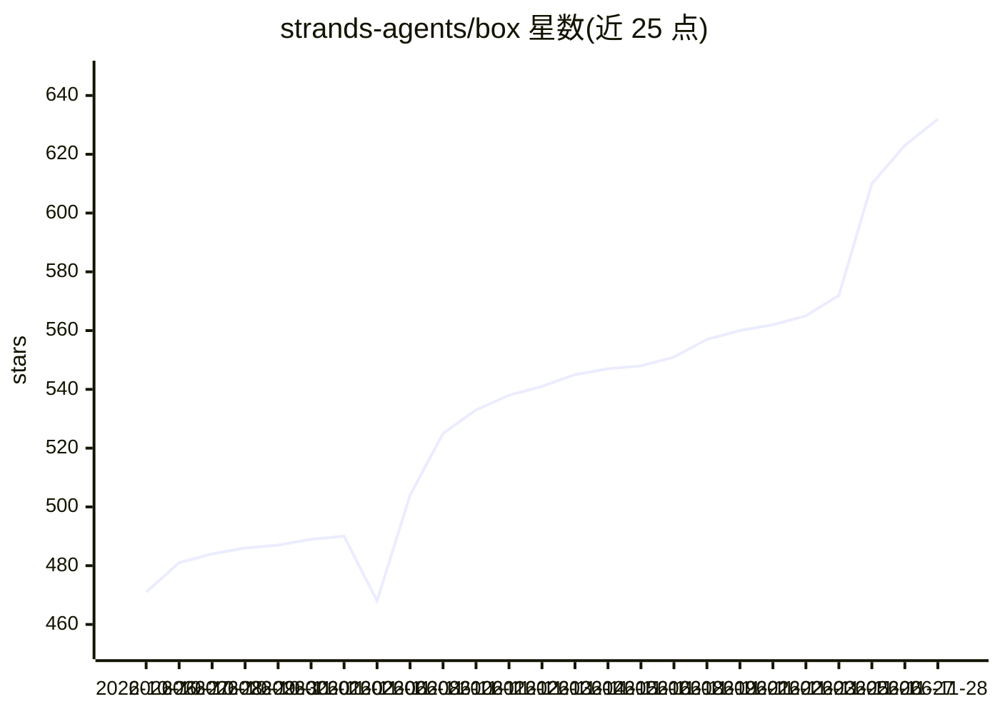

# strands-agents/box

⭐ 632 · Rust · Apache-2.0 · 推送 2026-11-27 · [GitHub](https://github.com/strands-agents/box) · [官网](https://strandsagents.com/box) · 组织维护

**在受控沙箱中运行 coding agent 的工具**

Box 让用户在本机上以 OS 级沙箱运行 Claude Code、Codex、Kiro CLI 等编码 agent：对文件、命令、网络与 MCP 工具调用的每次请求按默认拒绝策略（Dogwood 语言，支持基于历史行为的规则）检查后才放行，密钥保存在沙箱外、请求发出时以占位符替换注入。CLI 通过 profile 配置各 agent，底层引擎 Box Core 可独立下载、以 box.toml 配置，或作为 Rust 库嵌入应用。支持 Apple silicon macOS 15+ 与 Linux ARM64/x86-64，处于 preview 阶段。

## 筛选速览

| 维度 | 判定 | 备注 |
|---|---|---|
| AI 角色 | `ai-ecosystem` | LLM/agent 周边工具 |
| 许可风险 | `permissive` | Apache-2.0 |
| 部署形态 | `None` |  |
| 模型依赖 | locked-api |  |
| 硬件要求 | — | 无带数字的原话,不猜 |
| 安装摩擦 | `low` | 无编译、无系统依赖或容器化 |
| 成熟度 | `idea` | |

## 能力要点

- OS 沙箱 + 默认拒绝的 Dogwood 策略，逐请求检查文件/命令/网络/MCP 调用
- 凭据注入：密钥留在沙箱外，agent 只见占位符
- 策略规则可依赖 agent 已执行的行为（如每小时调用上限）
- Box Core 可独立运行、云部署或作为 Rust 库嵌入

## 适用场景

- 本机运行 Claude Code 等编码 agent 时限制其可读写的文件与可访问的网络
- 让 agent 在权限提示关闭的情况下安全使用，密钥不暴露给 agent
- 按团队策略约束 agent 对外部服务的调用频率与范围

## 场景标签

`编码 Agent` · 领域:编码与开发

## 证据(README 行号)

> L9:  Run coding agents like Claude Code in a sandbox, under a policy you control.
> L67: The agent runs in an OS sandbox inside the box. Its requests go to Box, which checks each one against your policy b

## 星数曲线

2026-10-26 471 → 2026-11-28 632（+161）

---
*卡片 v1 · prompt 1.4 · 生成 2026-11-26 · 置信度 high · 依据 README sha `a83ad87702f5` · [字段定义](../../DATASET.md)*
