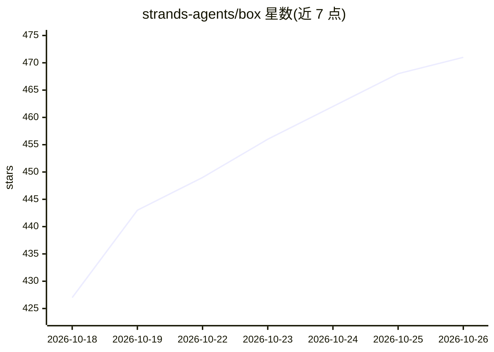

# strands-agents/box

⭐ 471 · Rust · Apache-2.0 · 推送 2026-10-25 · [GitHub](https://github.com/strands-agents/box) · [官网](https://strandsagents.com) · 组织维护

**Rust 编写的 AI agent 沙箱引擎：限制 agent 的执行/读写/网络访问**

开源沙箱引擎，用于运行 AI agent 并限制其可执行、读取、写入的程序与文件以及可访问的网络。结合操作系统隔离、默认拒绝的 Dogwood permit/forbid 语义策略，以及保持密钥在 agent 进程外的凭证注入（含 AWS SigV4 签名）。Strands Shell、Monty for Python、egress 网关与 MCP broker 共享事件历史，使规则可依据先前操作与时间判定后续请求。可作为 Rust 库或 CLI 使用；当前为 Preview，仅支持 Apple silicon 上的 macOS 本地执行，Linux 支持在描述中列为计划。

## 筛选速览

| 维度 | 判定 | 备注 |
|---|---|---|
| AI 角色 | `ai-ecosystem` | LLM/agent 周边工具 |
| 许可风险 | `permissive` | Apache-2.0 |
| 部署形态 | `None` |  |
| 模型依赖 | — | README 未给出锁定关系 |
| 硬件要求 | — | 无带数字的原话,不猜 |
| 安装摩擦 | `medium` | 含编译或系统依赖之一 |
| 成熟度 | `idea` | |

## 能力要点

- OS 隔离 + 默认拒绝的 Dogwood 语义策略（permit/forbid）
- 跨解释器与网关的共享事件历史，支持时间/历史相关的策略判定
- 凭证注入：agent 不接触底层密钥，网关代为认证
- 策略决策以 OTLP JSON 记录，可用于审计

## 适用场景

- 在受控沙箱中运行 coding agent，限制其文件与网络访问
- 按策略条件控制 agent 工具调用与 HTTP 出站请求
- 让 agent 使用 API 凭证但不泄露密钥给 agent 进程

## 场景标签

`网络安全` `Agent 框架` · 领域:Agent 开发

## 证据(README 行号)

> L20: Strands Box is an open source sandbox for AI agents.
> L25: Box is harness-agnostic. You choose the agent program or binary to run, configure

## 星数曲线

2026-10-18 427 → 2026-10-26 471（+44）

---
*卡片 v1 · prompt 1.4 · 生成 2026-10-21 · 置信度 high · 依据 README sha `d74c6d5d43dc` · [字段定义](../../DATASET.md)*
