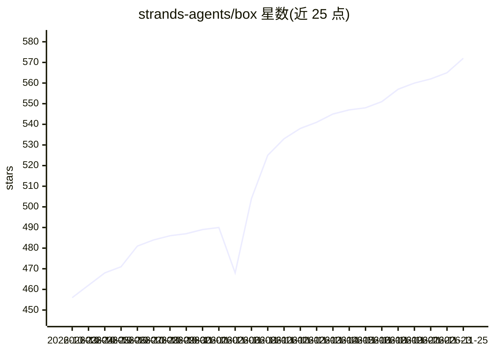

# strands-agents/box

⭐ 572 · Rust · Apache-2.0 · 推送 2026-11-24 · [GitHub](https://github.com/strands-agents/box) · [官网](https://strandsagents.com/box) · 组织维护

**在受限沙箱中运行编码 agent 的 CLI，控制其文件与网络访问**

Box 是一个用 Rust 编写的命令行工具：在 OS 级沙箱内运行 Claude Code、Codex、Kiro CLI 等编码 agent，对每次 shell 命令、网络请求和 MCP 工具调用按 Dogwood 策略（默认拒绝、可含状态依赖规则）进行检查，检查在模型之外执行。密钥通过占位符注入，不出现在 agent 可见范围内。提供 box CLI（profile 管理配置）与可独立运行或嵌入 Rust 应用的 Box Core 引擎。当前处于 preview，仅支持 Apple silicon Mac（macOS 15+）与 Linux ARM64/x86-64。

## 筛选速览

| 维度 | 判定 | 备注 |
|---|---|---|
| AI 角色 | `ai-ecosystem` | LLM/agent 周边工具 |
| 许可风险 | `permissive` | Apache-2.0 |
| 部署形态 | `None` |  |
| 模型依赖 | — | README 未给出锁定关系 |
| 硬件要求 | — | 无带数字的原话,不猜 |
| 安装摩擦 | `low` | 无编译、无系统依赖或容器化 |
| 成熟度 | `idea` | |

## 能力要点

- OS 沙箱 + 默认拒绝的 Dogwood 策略，逐条检查命令、网络与 MCP 调用
- 凭据注入：密钥留在沙箱外，agent 只见占位符
- Box Core 引擎可独立运行、云主机部署或作为 Rust 库嵌入
- 规则可依赖 agent 已执行的历史（如每小时 60 次调用上限）

## 适用场景

- 在本机安全地以宽松权限运行 Claude Code 等编码 agent
- 限制 agent 只能访问项目目录与白名单网络端点
- 让 agent 使用 Bedrock 等后端模型而不暴露真实密钥

## 场景标签

`编码 Agent` · 领域:编码与开发

## 证据(README 行号)

> L9:  Run coding agents like Claude Code in a sandbox, under a policy you control.
> L61: The agent runs in an OS sandbox inside the box. Its requests go to Box, which checks each one against your policy b
> L64: grant it. Box checks each shell command, network request, and MCP tool call against your policy

## 星数曲线

2026-10-23 456 → 2026-11-25 572（+116）

---
*卡片 v1 · prompt 1.4 · 生成 2026-11-25 · 置信度 high · 依据 README sha `43a7af3d8ad7` · [字段定义](../../DATASET.md)*
