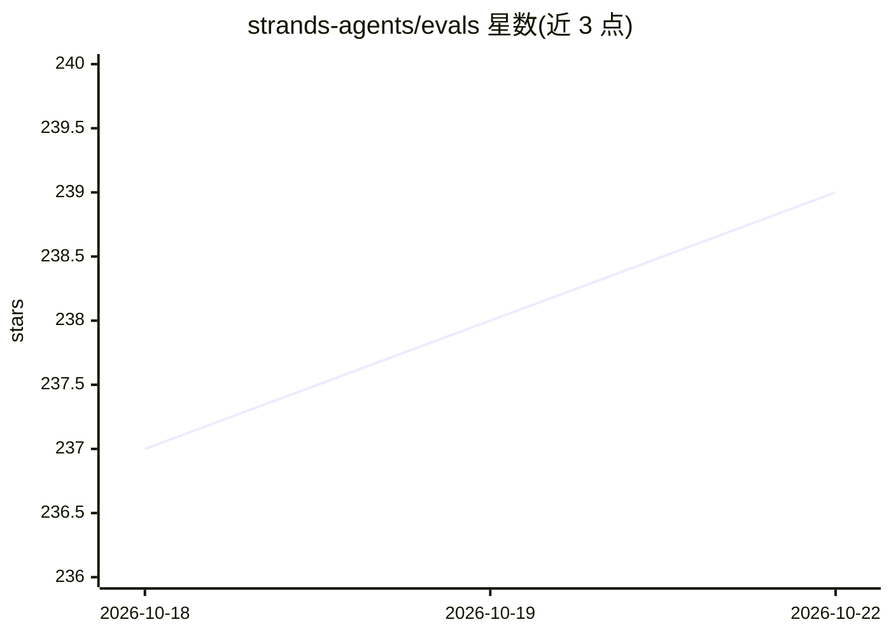

# strands-agents/evals

⭐ 241 · Python · Apache-2.0 · 推送 2026-10-22 · [GitHub](https://github.com/strands-agents/evals) · [官网](https://strandsagents.com) · 组织维护

**AI agent 与 LLM 应用的评测框架**

Strands Evals SDK 是面向 AI agent 和 LLM 应用的评测框架，提供输出评测、轨迹分析、工具使用评估、多轮对话模拟、LLM-as-a-Judge 评分、OpenTelemetry trace 评测、自动实验生成、失败检测与根因分析、混沌测试与红队评测等能力。配套 strands-evals 命令行工具（validate/run/report/diagnose/generate 五个子命令），实验以 JSON 序列化管理。要求 Python 3.10+，通过 pip 安装。部分评测器（如结构化输出相似度）支持离线确定性评分，无需 LLM 调用。

## 筛选速览

| 维度 | 判定 | 备注 |
|---|---|---|
| AI 角色 | `ai-ecosystem` | LLM/agent 周边工具 |
| 许可风险 | `permissive` | Apache-2.0 |
| 部署形态 | `library` | 以包/库形式分发 |
| 模型依赖 | — | README 未给出锁定关系 |
| 硬件要求 | — | 无带数字的原话,不猜 |
| 安装摩擦 | `low` | 无编译、无系统依赖或容器化 |
| 成熟度 | — | 结构信号不足 |

## 能力要点

- 输出/轨迹/工具使用/技能选择等多类评测器
- ActorSimulator 多轮对话模拟与 ToolSimulator 工具模拟
- strands-evals CLI 含 run/validate/report/diagnose/generate 五个子命令
- 混沌测试（确定性故障注入）与红队评测（含 Crescendo/PAIR 等攻击策略）

## 适用场景

- 为基于 Strands 的 agent 编写并运行评测实验
- 在 CI 中对实验 JSON 做模式校验并输出报告
- 不依赖真实 API 通过工具模拟测试 agent 行为
- 对 agent 会话做失败检测与根因分析

## 场景标签

 · 领域:LLM 基础设施/评测

## 证据(README 行号)

> L9:  A comprehensive evaluation framework for AI agents and LLM applications.
> L30: - **Multiple Evaluation Types**: Output evaluation, trajectory analysis, tool usage assessment, and interaction eva
> L60: Installing `strands-agents-evals` also installs the `strands-evals` console script, a thin wrapper over the Python 

## 星数曲线

2026-10-18 237 → 2026-10-22 239（+2）

---
*卡片 v1 · prompt 1.4 · 生成 2026-10-22 · 置信度 high · 依据 README sha `92dcd9d5a4f3` · [字段定义](../../DATASET.md)*
