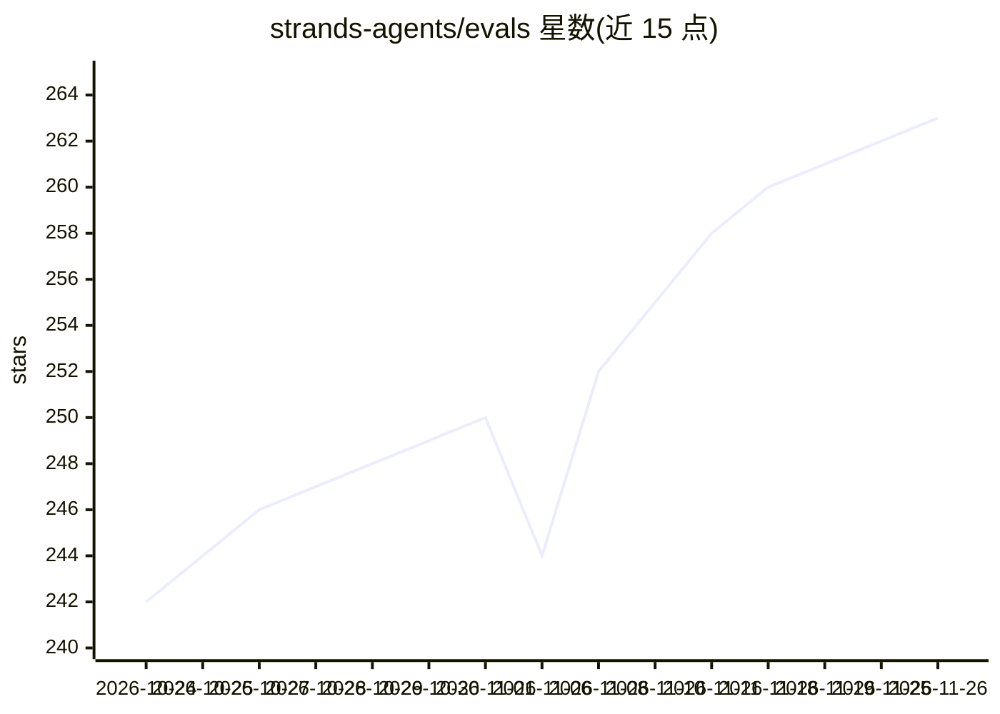

# strands-agents/evals

⭐ 263 · Python · Apache-2.0 · 推送 2026-11-25 · [GitHub](https://github.com/strands-agents/evals) · [官网](https://strandsagents.com) · 组织维护

**为 AI agent 与 LLM 应用提供评测的 Python 框架**

Strands Evals SDK 是面向 AI agent 与 LLM 应用的评测框架，覆盖输出评估、轨迹分析、工具使用评估与多轮交互评估。关键机制包括 LLM-as-a-Judge 评估器、基于 OpenTelemetry 轨迹的评估、多轮对话与工具模拟、从上下文描述自动生成实验、失败检测与根因分析、确定性故障注入的混沌测试及红队评估（Crescendo/GOAT/PAIR 等）。经 pip 安装并提供 CLI 子命令用于 CI 流程；需 Python 3.10+。

## 筛选速览

| 维度 | 判定 | 备注 |
|---|---|---|
| AI 角色 | `ai-ecosystem` | LLM/agent 周边工具 |
| 许可风险 | `permissive` | Apache-2.0 |
| 部署形态 | `library` | 以包/库形式分发 |
| 模型依赖 | — | README 未给出锁定关系 |
| 硬件要求 | — | 无带数字的原话,不猜 |
| 安装摩擦 | `low` | 无编译、无系统依赖或容器化 |
| 成熟度 | — | 结构信号不足 |

## 能力要点

- 多种评测类型：输出、轨迹、工具使用与多轮交互评估
- 多轮对话模拟与 LLM 驱动的工具模拟（支持共享状态与 schema 校验）
- 失败检测、根因分析与混沌测试（确定性故障注入）
- CLI 支持 validate/run/report/diagnose/generate 子命令

## 适用场景

- 在 CI 中对 agent 应用做输出与轨迹的自动评测
- 通过模拟用户对话测试 agent 能否完成目标
- 检测 agent 会话中的失败并分析根因
- 对 agent 做对抗性安全（红队）测试

## 场景标签

`模型评测` · 领域:评测与运维

## 证据(README 行号)

> L9:  A comprehensive evaluation framework for AI agents and LLM applications.
> L66: Installing `strands-agents-evals` also installs the `strands-evals` console script, a thin wrapper over the Python 
> L89: Ensure you have Python 3.10+ installed, then:

## 星数曲线

2026-10-24 242 → 2026-11-26 263（+21）

---
*卡片 v1 · prompt 1.4 · 生成 2026-11-25 · 置信度 high · 依据 README sha `71035b0976ee` · [字段定义](../../DATASET.md)*
