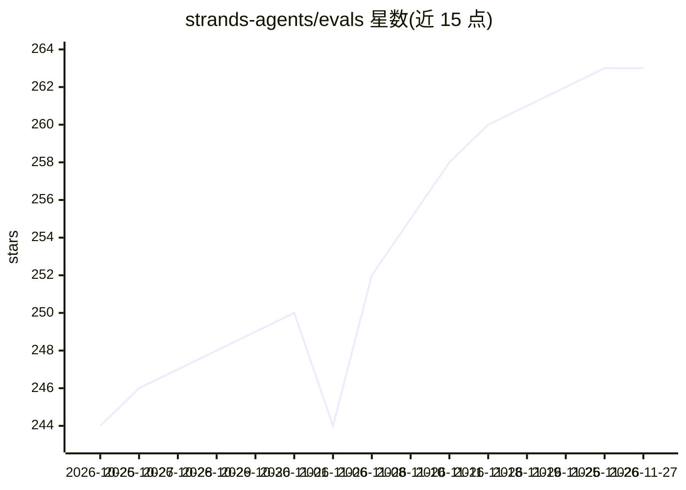

# strands-agents/evals

⭐ 263 · Python · Apache-2.0 · 推送 2026-11-25 · [GitHub](https://github.com/strands-agents/evals) · [官网](https://strandsagents.com) · 组织维护

**面向开发者的 AI agent 与 LLM 应用评测框架**

Strands Evals 是面向 AI agent 与 LLM 应用评测的 Python SDK 与 CLI：覆盖输出评测、轨迹分析、工具使用评估、多轮对话模拟、LLM-as-a-Judge 打分、基于 OpenTelemetry 轨迹的评测、失败检测与根因诊断、混沌测试、红队安全测试与 agent 配置优化。实验以 JSON 序列化保存与版本化，内置 UI 在本地浏览与编辑实验/报告，并提供 Copy as Markdown 等面向 coding agent 的接口。安装方式为 pip。

## 筛选速览

| 维度 | 判定 | 备注 |
|---|---|---|
| AI 角色 | `ai-ecosystem` | LLM/agent 周边工具 |
| 许可风险 | `permissive` | Apache-2.0 |
| 部署形态 | `library` | 以包/库形式分发 |
| 模型依赖 | — | README 未给出锁定关系 |
| 硬件要求 | — | 无带数字的原话,不猜 |
| 安装摩擦 | `low` | 无编译、无系统依赖或容器化 |
| 成熟度 | — | 结构信号不足 |

## 能力要点

- 多种评测类型：输出、轨迹、工具使用、交互评测，含图像任务 MLLM-as-a-Judge
- CLI 提供 run/validate/report/diagnose/generate/fetch/optimize/ui 八个子命令
- 失败自动检测与根因分析，附修复建议
- 红队评测内置 Crescendo、GOAT、PAIR 等攻击策略

## 适用场景

- 上线前对 agent 做批量实验评测并在 CI 中门禁校验
- 诊断失败会话的根因并获得修复建议
- 对 agent 做红队对抗性安全测试
- 自动搜索更优的 agent 提示词与工具配置

## 场景标签

`模型评测` · 领域:评测与运维

## 证据(README 行号)

> L9:  A comprehensive evaluation framework for AI agents and LLM applications.
> L31: Strands Evaluation is a powerful framework for evaluating AI agents and LLM applications. From simple output valida
> L35: - **Multiple Evaluation Types**: Output evaluation, trajectory analysis, tool usage assessment, and interaction eva

## 星数曲线

2026-10-25 244 → 2026-11-27 263（+19）

---
*卡片 v1 · prompt 1.4 · 生成 2026-11-26 · 置信度 mid · 依据 README sha `4bb426768cfc` · [字段定义](../../DATASET.md)*
