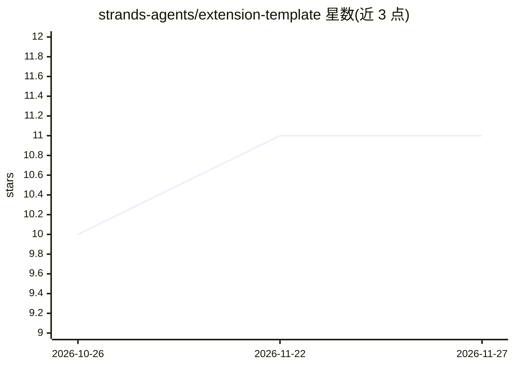

# strands-agents/extension-template

⭐ 11 · TypeScript · Apache-2.0 · 推送 2026-11-18 · [GitHub](https://github.com/strands-agents/extension-template) · [官网](https://strandsagents.com) · 组织维护

**为 Strands Agents 开发者生成扩展组件项目骨架的模板仓库**

Strands Agents 官方的扩展开发模板 monorepo，提供 Python 与 TypeScript 两套起始模板。每个模板包含主要扩展点的骨架代码、交互式 setup 脚本（按选择删减组件、重命名为目标包名、配置 pyproject.toml/package.json），以及接好 PyPI/npm 发布的 CI 工作流。覆盖八类扩展点：工具、模型提供方、插件、干预控制、会话管理、记忆存储、存储与决策模型。通过 GitHub 'Use this template' 开始使用。

## 筛选速览

| 维度 | 判定 | 备注 |
|---|---|---|
| AI 角色 | `ai-ecosystem` | LLM/agent 周边工具 |
| 许可风险 | `permissive` | Apache-2.0 |
| 部署形态 | `library` | 以包/库形式分发 |
| 模型依赖 | — | README 未给出锁定关系 |
| 硬件要求 | — | 无带数字的原话,不猜 |
| 安装摩擦 | `low` | 无编译、无系统依赖或容器化 |
| 成熟度 | — | 结构信号不足 |

## 能力要点

- Python 与 TypeScript 双语言模板，共享八个扩展点骨架
- 交互式 setup 脚本定制包名与依赖配置
- CI/publish 工作流预接 PyPI 与 npm
- 扩展点含 Tool、Model provider、Plugin、Intervention 等

## 适用场景

- 为 Strands Agents 编写自定义工具并发布到 PyPI/npm
- 接入自定义 LLM API 作为模型提供方
- 为 agent 构建守门与干预控制组件

## 场景标签

 · 领域:AI agent 框架/开发工具

## 证据(README 行号)

> L22: This monorepo contains starter templates for building custom Strands Agents extensions in two languages. Each templ
> L41: Both templates expose the same eight Strands extension points so you can pick whichever fits your use case:

## 星数曲线

2026-10-26 10 → 2026-11-27 11（+1）

---
*卡片 v1 · prompt 1.4 · 生成 2026-11-19 · 置信度 mid · 依据 README sha `1f53765ffbfc` · [字段定义](../../DATASET.md)*
