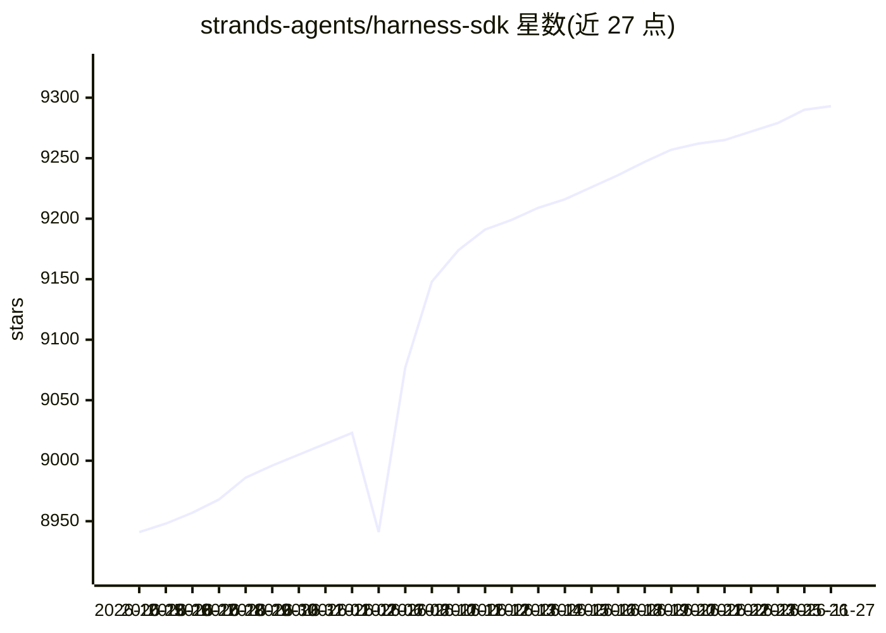

# strands-agents/harness-sdk

⭐ 9,293 · TypeScript · Apache-2.0 · 推送 2026-11-26 · [GitHub](https://github.com/strands-agents/harness-sdk) · [官网](http://strandsagents.com/) · 组织维护

**Python/TypeScript 开源 SDK：构建并端到端控制 AI agent**

Strands Agents 是在 Python 与 TypeScript 中构建和运行 AI agent 的开源 SDK，以模型驱动方式用少量代码搭建 agent 循环。SDK 内置生命周期控制（轮次上限、token 预算、取消）、工具与结构化输出、MCP、多 agent 模式、记忆与会话、流式、护栏、追踪与评测；另提供组装好的 harness（create_harness/createHarness）、CLI、MCP server 与文档站，以 monorepo 形式组织。模型可替换，默认走 Amazon Bedrock（TypeScript），需配置 AWS 凭证或传入其他模型。

## 筛选速览

| 维度 | 判定 | 备注 |
|---|---|---|
| AI 角色 | `ai-ecosystem` | LLM/agent 周边工具 |
| 许可风险 | `permissive` | Apache-2.0 |
| 部署形态 | `library` | 以包/库形式分发 |
| 模型依赖 | local-ok | 支持本地模型 |
| 硬件要求 | — | 无带数字的原话,不猜 |
| 安装摩擦 | `low` | 无编译、无系统依赖或容器化 |
| 成熟度 | — | 结构信号不足 |

## 能力要点

- Python 与 TypeScript 双 SDK，含 agent 循环、模型 providers 与工具
- harness 通过 create_harness()/createHarness() 提供带基准默认值的组装 agent
- 内置 MCP、双向流式、多 agent 模式、护栏、追踪与评测
- CLI 与面向编码 agent 的 MCP server、Claude Code/Codex/Cursor 插件

## 适用场景

- 用几行代码搭建生产级 agent 而非手写 agent 循环
- 在本地进程内运行 agent，无需托管控制平面
- 统一接口切换多家模型 provider 与云后端
- 为编码 agent 提供 Strands 脚手架与文档知识

## 场景标签

`Agent 框架` `多智能体` · 领域:Agent 开发

## 证据(README 行号)

> L29: Strands Agents is an open-source SDK for building and running AI agents in Python and TypeScript. Choose Strands wh
> L56: - **Model agnostic.** First-class support for Amazon Bedrock, Anthropic, OpenAI, and Gemini, plus many more provide
> L98: The Strands Harness SDK lets you go deeper and control every part of the agent: the loop, tools, model providers, m

## 星数曲线

2026-10-25 8,941 → 2026-11-27 9,293（+352）

---
*卡片 v1 · prompt 1.4 · 生成 2026-11-22 · 置信度 high · 依据 README sha `4866c1160bba` · [字段定义](../../DATASET.md)*
