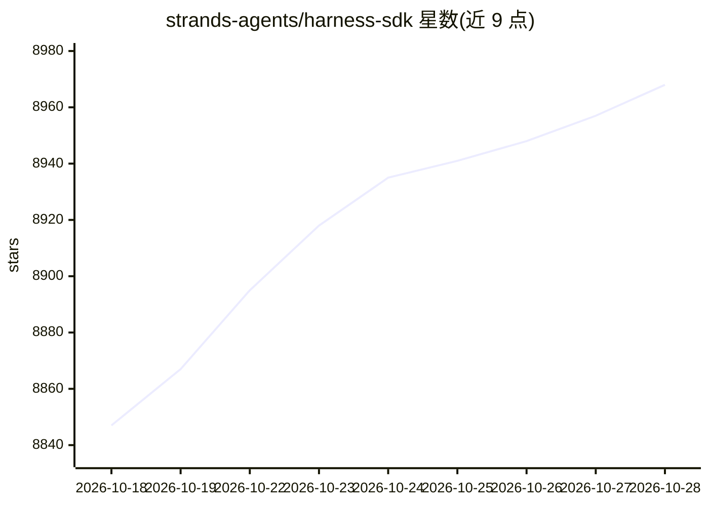

# strands-agents/harness-sdk

⭐ 8,986 · Python · Apache-2.0 · 推送 2026-10-28 · [GitHub](https://github.com/strands-agents/harness-sdk) · [官网](http://strandsagents.com/) · 组织维护

**构建并端到端控制 AI agent 的开源 SDK（Python/TypeScript）**

提供 Python 与 TypeScript 双语言的 agent 构建工具：harness 一行调用生成预配置 agent，SDK 层可自控 agent 循环、工具、模型提供方、内存与会话。内置生命周期控制（轮次限制、token 预算、取消）、MCP、多 agent 模式、流式输出、护栏、追踪与评测。模型可选 Amazon Bedrock、Anthropic、OpenAI、Gemini、Ollama 等。面向需要在自有进程内运行 agent、无托管控制面的开发者。要求 Python 3.10+ 或 Node.js 22+。

## 筛选速览

| 维度 | 判定 | 备注 |
|---|---|---|
| AI 角色 | `ai-ecosystem` | LLM/agent 周边工具 |
| 许可风险 | `permissive` | Apache-2.0 |
| 部署形态 | `library` | 以包/库形式分发 |
| 模型依赖 | local-ok | 支持本地模型 |
| 硬件要求 | — | 无带数字的原话,不猜 |
| 安装摩擦 | `low` | 无编译、无系统依赖或容器化 |
| 成熟度 | — | 结构信号不足 |

## 能力要点

- harness 一行调用（create_harness/createHarness）生成带默认配置的完整 agent
- 内置生命周期控制、MCP、多 agent 模式、护栏、追踪与评测
- 模型无关：支持 Bedrock、Anthropic、OpenAI、Gemini、Ollama 及自定义提供方
- 进程内运行，无托管控制平面

## 适用场景

- 在 Python/TypeScript 应用中构建生产级 AI agent
- 需要自控 agent 循环、工具与内存的高级定制
- 为 AI 编码助手提供框架脚手架与迁移指引

## 场景标签

`Agent 框架` `多智能体` · 领域:Agent 开发

## 证据(README 行号)

> L26: Strands Agents is an open-source SDK for building and running AI agents in Python and TypeScript. Choose Strands wh
> L95: The Strands Harness SDK lets you go deeper and control every part of the agent: the loop, tools, model providers, m

## 星数曲线

2026-10-18 8,847 → 2026-10-28 8,968（+121）

---
*卡片 v1 · prompt 1.4 · 生成 2026-10-20 · 置信度 high · 依据 README sha `268b81c23de3` · [字段定义](../../DATASET.md)*
