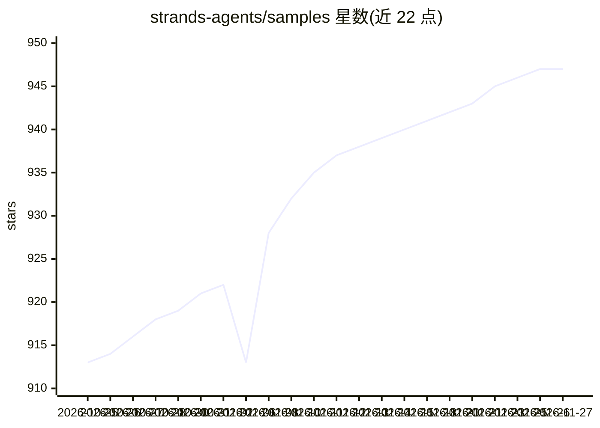

# strands-agents/samples

⭐ 947 · Python · Apache-2.0 · 推送 2026-11-18 · [GitHub](https://github.com/strands-agents/samples) · [官网](https://strandsagents.com) · 组织维护

**Strands Agents SDK 的示例集：帮开发者上手构建 AI Agent**

Strands Agents 官方示例仓库，收录 Python 与 TypeScript 两种 SDK 的可运行示例，按 8 个目录组织：SDK 教程、Lambda/Fargate/AgentCore 部署模式、AWS 服务与数据库集成、金融/医疗/零售等行业用例、Agentic RAG 等架构模式、评测教程、全栈 UX 演示，以及边缘设备与机器人集成。README 提供虚拟环境创建、pip/uv/npm 安装与首个 Agent 示例代码，并声明示例仅用于演示与教学，投入生产前需自行补充安全与测试流程。

## 筛选速览

| 维度 | 判定 | 备注 |
|---|---|---|
| AI 角色 | `ai-knowledge` | 知识聚合/清单类 |
| 许可风险 | `permissive` | Apache-2.0 |
| 部署形态 | `library` | 以包/库形式分发 |
| 模型依赖 | — | README 未给出锁定关系 |
| 硬件要求 | — | 无带数字的原话,不猜 |
| 安装摩擦 | `low` | 无编译、无系统依赖或容器化 |
| 成熟度 | — | 结构信号不足 |

## 能力要点

- Python 与 TypeScript 双 SDK 示例，首个 Agent 仅需数行代码
- 覆盖部署（Lambda/Fargate/AgentCore）、集成、评测、边缘/机器人等 8 类目录
- 支持 pip 与 uv 两种 Python 安装路径
- 官方声明示例仅供演示教学，不建议直接用于生产

## 适用场景

- 按教程逐步学习 Strands Agents SDK 的基础与多 Agent 系统
- 参考行业用例示例搭建金融、医疗、零售领域的 Agent 应用
- 查阅 Agentic RAG 等架构模式的参考实现
- 了解 Agent 在 Lambda/Fargate/AgentCore 上的部署方式

## 场景标签

`教程课程` `多智能体` `RAG` `模型评测` · 领域:Agent 开发

## 证据(README 行号)

> L29: Welcome to the Strands Agents Samples repository!
> L33: The examples in this repository are for **demonstration and educational purposes** only. They demonstrate concepts 
> L135: - **01-learn** - SDK tutorials covering fundamentals, multi-agent systems, and streaming

## 星数曲线

2026-10-25 913 → 2026-11-27 947（+34）

---
*卡片 v1 · prompt 1.4 · 生成 2026-11-24 · 置信度 high · 依据 README sha `3c0483268723` · [字段定义](../../DATASET.md)*
