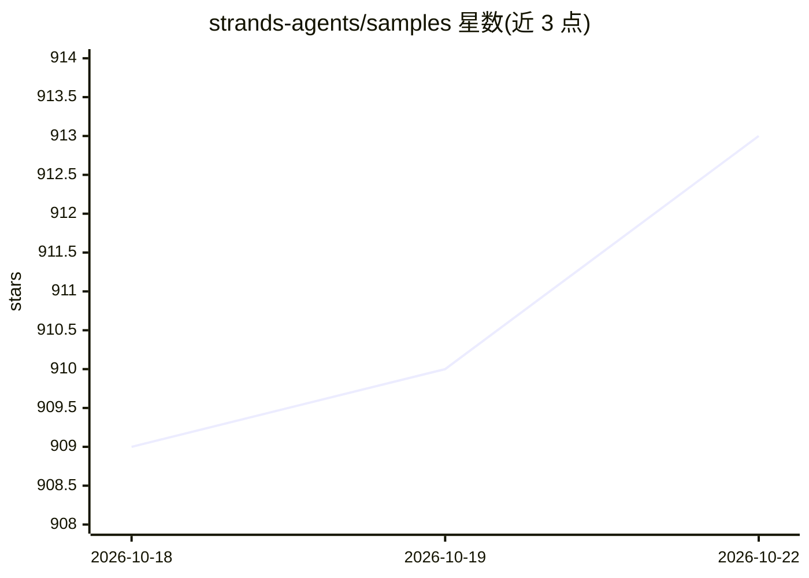

# strands-agents/samples

⭐ 913 · Python · Apache-2.0 · 推送 2026-10-21 · [GitHub](https://github.com/strands-agents/samples) · [官网](https://strandsagents.com) · 组织维护

**Strands Agents SDK 的示例代码集：帮助开发者入门 AI agent 开发**

Strands Agents SDK 的官方示例仓库，提供 Python 与 TypeScript 两种语言的教程式样例：Python 侧涵盖基础、多 agent、流式、部署模式（Lambda/Fargate/AgentCore）、AWS 服务集成、行业用例、Agentic RAG 架构、评测与边缘设备集成等 8 组；TypeScript 侧含学习与部署示例。通过 pip 或 npm 安装 SDK 即可运行，示例声明仅供演示与教学、不直接用于生产。

## 筛选速览

| 维度 | 判定 | 备注 |
|---|---|---|
| AI 角色 | `ai-ecosystem` | LLM/agent 周边工具 |
| 许可风险 | `permissive` | Apache-2.0 |
| 部署形态 | `library` | 以包/库形式分发 |
| 模型依赖 | — | README 未给出锁定关系 |
| 硬件要求 | — | 无带数字的原话,不猜 |
| 安装摩擦 | `low` | 无编译、无系统依赖或容器化 |
| 成熟度 | — | 结构信号不足 |

## 能力要点

- Python 示例 8 组：学习/部署/集成/行业用例/架构/评测/UX/边缘
- TypeScript SDK 示例与部署模式
- pip 与 npm 两条安装路径，附首个 agent 的最小可运行代码
- 示例明确声明仅供演示与教学用途

## 适用场景

- 学习如何用 Strands SDK 构建 AI agent
- 查找 agent 部署到 Lambda/Fargate/AgentCore 的参考模式
- 了解 Agentic RAG 与多 agent 系统的实现方式

## 场景标签

 · 领域:AI agent 开发/示例代码

## 证据(README 行号)

> L9:  A model-driven approach to building AI agents in just a few lines of code.
> L25: Welcome to the Strands Agents Samples repository!

## 星数曲线

2026-10-18 909 → 2026-10-22 913（+4）

---
*卡片 v1 · prompt 1.4 · 生成 2026-10-21 · 置信度 high · 依据 README sha `aef30ba1a903` · [字段定义](../../DATASET.md)*
