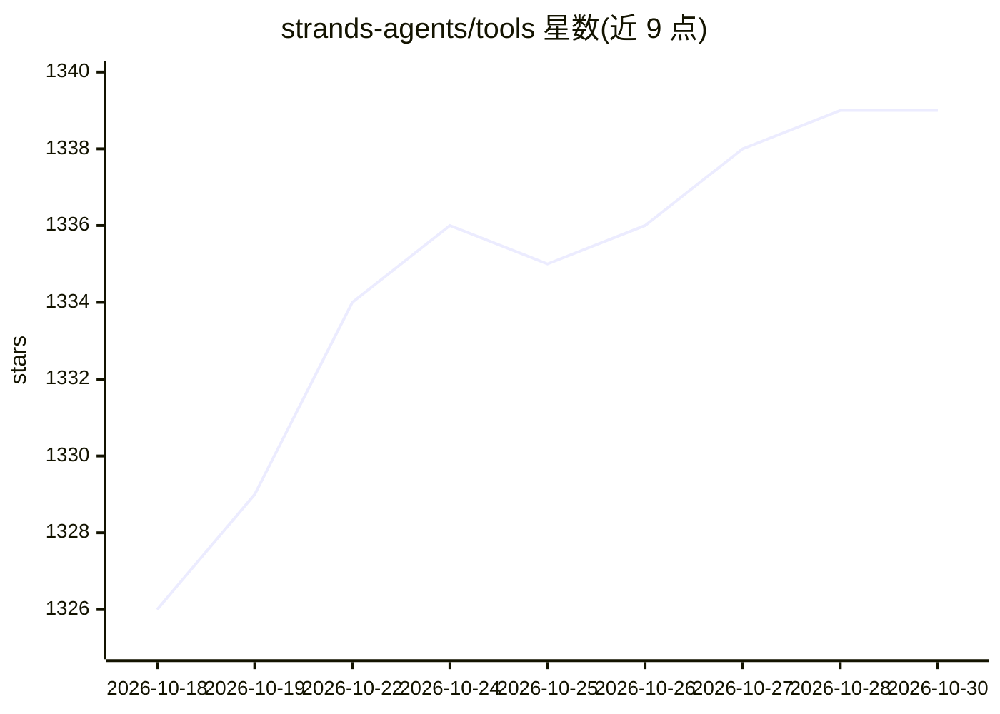

# strands-agents/tools

⭐ 1,339 · Python · Apache-2.0 · 推送 2026-10-29 · [GitHub](https://github.com/strands-agents/tools) · [官网](https://strandsagents.com) · 组织维护

**为 Strands Agents 提供 30+ 现成工具的 Python 工具库**

Strands Agents 生态的社区驱动工具集合，pip 安装 strands-agents-tools 后供 agent 调用。覆盖文件读写、shell 执行、Python 沙箱执行、HTTP 请求、AWS 服务访问、记忆存储（Mem0/Bedrock Knowledge Bases/Elasticsearch/MongoDB）、网页搜索（Tavily/Exa）、Slack、图像与视频生成、多智能体 Swarm 与 DAG 图编排、动态 MCP 客户端、浏览器与桌面自动化等。README 声明工具为实验性质且多处标注 Deprecated，生产使用需自行安全审查。

## 筛选速览

| 维度 | 判定 | 备注 |
|---|---|---|
| AI 角色 | `ai-ecosystem` | LLM/agent 周边工具 |
| 许可风险 | `permissive` | Apache-2.0 |
| 部署形态 | `library` | 以包/库形式分发 |
| 模型依赖 | — | README 未给出锁定关系 |
| 硬件要求 | — | 无带数字的原话,不猜 |
| 安装摩擦 | `low` | 无编译、无系统依赖或容器化 |
| 成熟度 | `idea` | |

## 能力要点

- 文件/Shell/Python REPL/HTTP 等基础能力工具
- 记忆工具支持 Mem0、Bedrock Knowledge Bases、Elasticsearch、MongoDB Atlas
- Swarm 多智能体协作与 DAG 多智能体图编排
- 动态 MCP 客户端可连接外部 MCP 服务器加载远程工具

## 适用场景

- 为 Strands agent 快速挂载文件、执行、检索等现成工具
- 构建带记忆的多轮个性化 agent
- 搭建多智能体协作或 DAG 流水线

## 场景标签

`多智能体` `GUI 自动化` `Agent 记忆` · 领域:Agent 开发

## 证据(README 行号)

> L26: Strands Agents Tools is a community-driven project that provides a powerful set of tools for your agents to use. It
> L9:  A model-driven approach to building AI agents in just a few lines of code.

## 星数曲线

2026-10-18 1,326 → 2026-10-30 1,339（+13）

---
*卡片 v1 · prompt 1.4 · 生成 2026-10-21 · 置信度 high · 依据 README sha `6c4231e0d4bb` · [字段定义](../../DATASET.md)*
