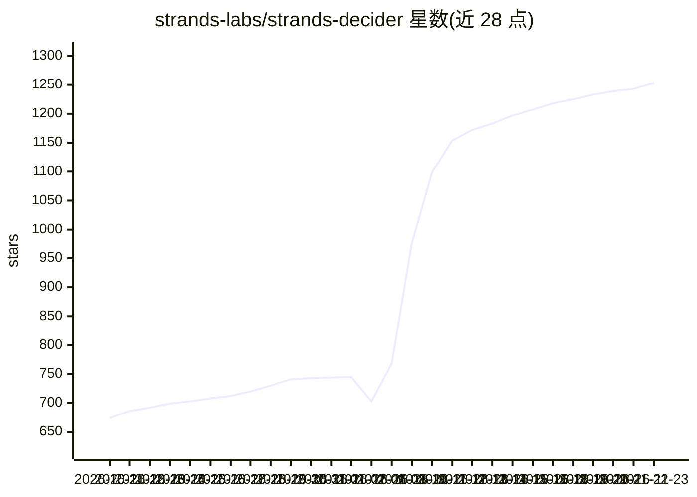

# strands-labs/strands-decider

⭐ 1,253 · Python · Apache-2.0 · 推送 2026-11-21 · [GitHub](https://github.com/strands-labs/strands-decider) · [官网](https://strandsagents.com/docs/labs/) · 组织维护

**给 agentic 工作流的快速决策模型：选项判定与打分**

Strands Decider 是一个决策模型（自称 system one 模型）：在预训练 LLM 主干上丢弃语言建模头，换成约百万参数的指针头，单次前向即可从选项中挑选或按量表打分，不做文本生成。提供三种问题类型（noul 是/否、choice 多选一、score 有序评分），每次决策附带校准置信度。以 CLI 和 HTTP 服务器形式提供，基于 Qwen3.5 与 Gemma 4 基座，支持 CPU、CUDA、MPS、MLX 设备，模型权重发布在 Hugging Face。

## 筛选速览

| 维度 | 判定 | 备注 |
|---|---|---|
| AI 角色 | `ai-native` | 本体是模型或模型工具 |
| 许可风险 | `permissive` | Apache-2.0 |
| 部署形态 | `library` | 以包/库形式分发 |
| 模型依赖 | — | README 未给出锁定关系 |
| 硬件要求 | — | 无带数字的原话,不猜 |
| 安装摩擦 | `medium` | 含编译或系统依赖之一 |
| 成熟度 | — | 结构信号不足 |

## 能力要点

- 单次前向输出的指针头架构，不做生成与解码循环
- 三种问题类型：choice/noul/score，附带校准置信度
- 以 CLI 与 HTTP 服务器形式提供，支持 --vision 图像输入
- 提供 2B 至 26B-A4B 多个尺寸，全部可在 CPU 运行

## 适用场景

- 在 agent 工作流中做路由决策（如按工单内容选择处理团队）
- 对文本做快速情感/紧急度打分
- 对文档图像做是/否判断（如签名栏是否填写）

## 场景标签

`推理引擎` · 领域:训练与推理

## 证据(README 行号)

> L20: Strands decider is one of a new class of **decision models**, or "system one" models. Unlike an
> L23: and traditional classification models: it is a general-purpose classification and scoring
> L26: agentic workflows built with the Strands Agents SDK.

## 星数曲线

2026-10-21 674 → 2026-11-23 1,253（+579）

---
*卡片 v1 · prompt 1.4 · 生成 2026-11-23 · 置信度 high · 依据 README sha `cb86d5d3f95c` · [字段定义](../../DATASET.md)*
