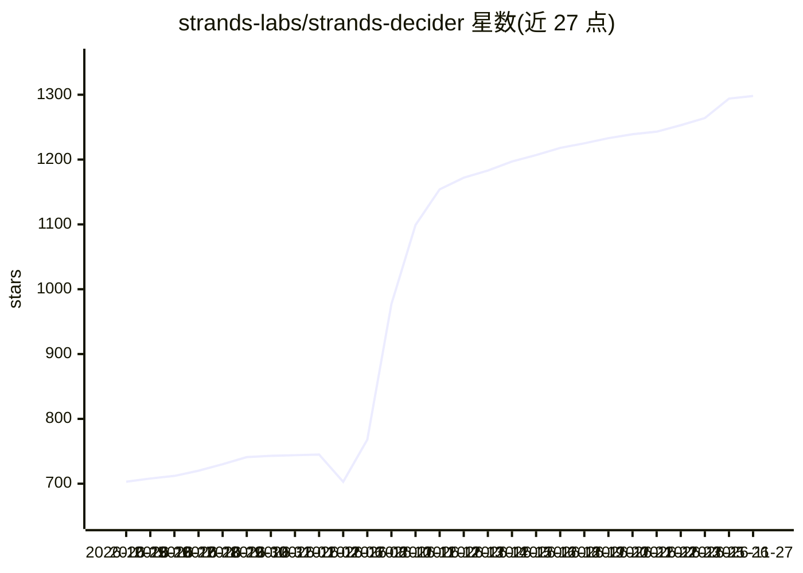

# strands-labs/strands-decider

⭐ 1,298 · Python · Apache-2.0 · 推送 2026-11-26 · [GitHub](https://github.com/strands-labs/strands-decider) · [官网](https://strandsagents.com/docs/labs/) · 组织维护

**面向 agent 工作流的小型快速决策模型，输出选项判定与置信度**

Strands Decider 是'决策模型'（system one 模型）：基于预训练 decoder 主体加一个 readout 头，一次前向、无生成，从给定选项中做出选择、回答 Yes/No（noul）或给出量表分数，每个决策附带校准置信度。提供 CLI 与 HTTP server 两种使用方式，模型权重托管在 Hugging Face。v2 系列基于 Gemma 4，共五个尺寸（E2B 至 31B），支持 32,768 token 上下文与图像输入；选项由请求动态给出，新增类别无需重训练。小尺寸模型可在 24 GB GPU 或 CPU 上运行。

## 筛选速览

| 维度 | 判定 | 备注 |
|---|---|---|
| AI 角色 | `ai-native` | 本体是模型或模型工具 |
| 许可风险 | `permissive` | Apache-2.0 |
| 部署形态 | `library` | 以包/库形式分发 |
| 模型依赖 | — | README 未给出锁定关系 |
| 硬件要求 | — | 无带数字的原话,不猜 |
| 安装摩擦 | `medium` | 含编译或系统依赖之一 |
| 成熟度 | — | 结构信号不足 |

## 能力要点

- 三种问题类型：choice（选项选择）、noul（Yes/No）、score（量表评分）
- 每个决策携带校准置信度，0.9 以上置信度约 95% 正确率
- token readout 架构：一次前向、无生成，选项来自请求无需重训练
- 支持图像输入与 32,768 token 上下文

## 适用场景

- agent 工作流中代替 LLM 做快速选项判定
- 对文本情感或用户情绪做量表打分
- 客服请求的自动分类与分流
- 对文档图像内容做是/否判断

## 场景标签

 · 领域:AI 模型/推理

## 证据(README 行号)

> L11:  A small, fast decision model for agentic AI.
> L26: Strands decider is one of a new class of **decision models**, or "system one" models. Unlike an
> L32: agentic workflows built with the Strands Agents SDK.

## 星数曲线

2026-10-25 703 → 2026-11-27 1,298（+595）

---
*卡片 v1 · prompt 1.4 · 生成 2026-11-24 · 置信度 high · 依据 README sha `b2659921bd68` · [字段定义](../../DATASET.md)*
