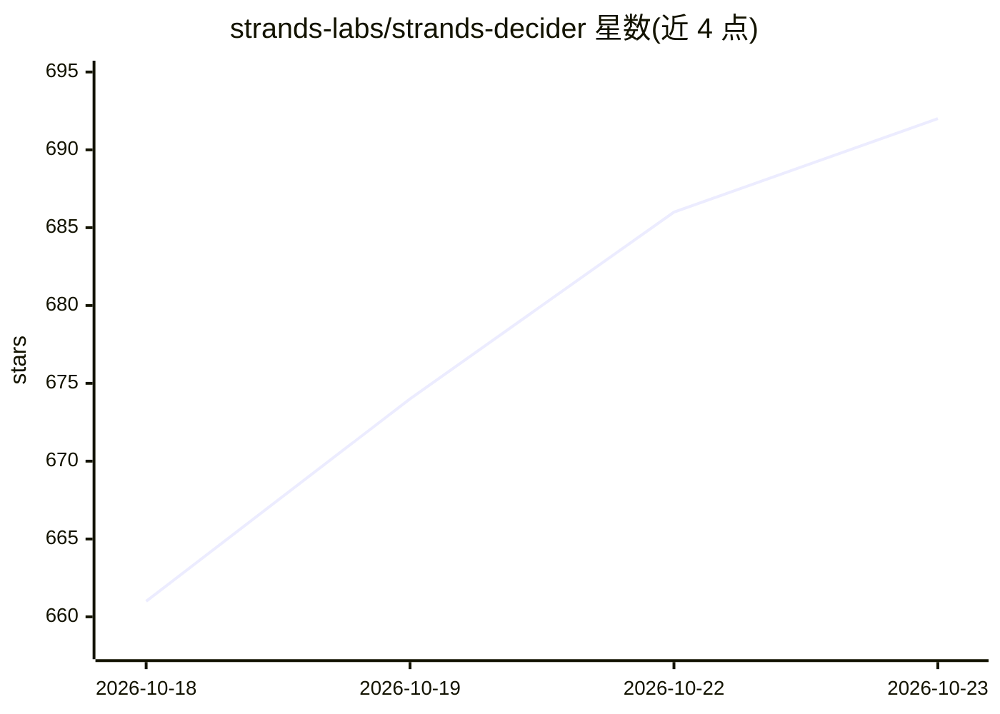

# strands-labs/strands-decider

⭐ 692 · Python · Apache-2.0 · 推送 2026-10-21 · [GitHub](https://github.com/strands-labs/strands-decider) · [官网](https://strandsagents.com/docs/labs/) · 组织维护

**面向 agent 工作流的小型快速决策模型（system one 模型）**

一种新型“决策模型”：基于预训练 decoder LLM 躯干（如 Qwen3.5-2B-Base），去掉语言建模头、换成约百万参数的指针头，单次前向输出选项选择（choice）、是非判断（noul）与量表评分（score）三类结果，每个决策附带校准置信度；比 LLM 响应更快，且无需训练传统分类器。以 pip 包与 CLI 提供，可本地运行或以 HTTP 服务器部署，支持 CPU/MPS/CUDA/MLX 设备与视觉输入（Qwen3.5 模型）。模型发布在 Hugging Face 的 StrandsAgents 与 amazon 组织下，覆盖 2B 至 26B 多个尺寸。

## 筛选速览

| 维度 | 判定 | 备注 |
|---|---|---|
| AI 角色 | `ai-native` | 本体是模型或模型工具 |
| 许可风险 | `permissive` | Apache-2.0 |
| 部署形态 | `library` | 以包/库形式分发 |
| 模型依赖 | — | README 未给出锁定关系 |
| 硬件要求 | — | 无带数字的原话,不猜 |
| 安装摩擦 | `medium` | 含编译或系统依赖之一 |
| 成熟度 | — | 结构信号不足 |

## 能力要点

- choice/noul/score 三类问题共用同一 masked softmax，标签集由请求定义
- 每个决策输出校准置信度（置信度≥0.9 时准确率约 95%）
- 单次前向无生成循环：2B 模型在 RTX 3090 上中位延迟 115 ms
- 文本只读一次，同一文本多问题各只加自身 token，成本低

## 适用场景

- 在 agent 工作流中做路由/分诊等快速二选一或多项选择
- 对文本做情感、紧急度等量表评分并获取置信度
- 以 HTTP 服务形式给其他系统提供低延迟决策接口

## 场景标签

 · 领域:AI 模型/agent 基础设施

## 证据(README 行号)

> L18: Strands decider is one of a new class of **decision models**, or "system one" models. Unlike an
> L19: LLM, which can generate arbitrary text, a decision model picks between sets of options and
> L20: rates things on a scale. This class of model works best for problems that fall between LLMs
> L63: choice_0 -> billing (confidence 0.659)

## 星数曲线

2026-10-18 661 → 2026-10-23 692（+31）

---
*卡片 v1 · prompt 1.4 · 生成 2026-10-21 · 置信度 high · 依据 README sha `ce095ea448ed` · [字段定义](../../DATASET.md)*
