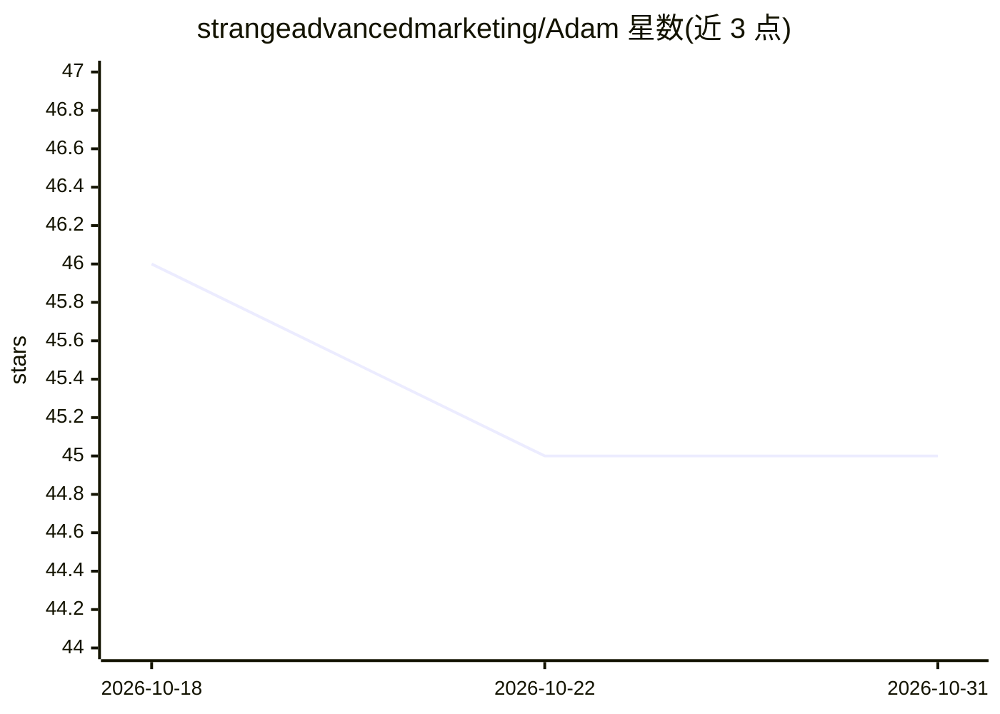

# strangeadvancedmarketing/Adam

⭐ 45 · Python · MIT · 推送 2026-07-12 · [GitHub](https://github.com/strangeadvancedmarketing/Adam) · [官网](https://strangeadvancedmarketing.github.io/Adam/) · 个人维护

**给本地 AI 助手的 5 层持久记忆与身份架构（基于 OpenClaw）**

基于 OpenClaw 运行时的 agent harness：用磁盘上的纯 Markdown 文件与神经图构建 5 层持久记忆、一致性与身份系统，包含启动时身份注入、会话内一致性监控（Layer 5）、夜间 sleep cycle 归并日志等。身份数据存于用户自有文件，宣称可跨模型迁移与机器重置存活。支持 Gemini/OpenAI/Anthropic/Ollama 多 provider，提供 SWARM 多 agent 文件队列编排、webhook 事件触发、Electron 桌面伴侣与 pip 安装的 CLI。附带 $49 付费 Fast-Track 安装支持包。另含基于 IBM Quantum 的研究章节。

## 筛选速览

| 维度 | 判定 | 备注 |
|---|---|---|
| AI 角色 | `ai-ecosystem` | LLM/agent 周边工具 |
| 许可风险 | `permissive` | MIT |
| 部署形态 | `self-host` | docker 或自建部署 |
| 模型依赖 | local-ok | 支持本地模型 |
| 硬件要求 | — | 无带数字的原话,不猜 |
| 安装摩擦 | `low` | 无编译、无系统依赖或容器化 |
| 成熟度 | — | 结构信号不足 |

## 能力要点

- 5 层架构：Vault 注入、神经图、sleep cycle、一致性监控等同时运行
- 多 provider 抽象层：Gemini/OpenAI/Anthropic/Ollama/OpenAI 兼容端点可切换且 Vault 保留
- SWARM 多 agent 任务编排：文件即队列，锁防重复处理，附 CLI 管理命令
- webhook 事件总线与 Electron 桌面 HUD 伴侣

## 适用场景

- 让本地 AI 助手跨会话保留项目上下文与关系历史
- 从 Claude/ChatGPT 导出历史对话，预先填充神经图
- 在模型或厂商更换时保留 AI 的记忆与身份文件

## 场景标签

`Agent 记忆` `多智能体` · 领域:Agent 开发

## 证据(README 行号)

> L76: The Adam Framework is a **5-layer persistent memory, coherence, and identity architecture** for local AI assistants
> L197: Switch models without losing anything. The provider abstraction layer works with Gemini, OpenAI, Anthropic, Ollama

## 星数曲线

2026-10-18 46 → 2026-10-31 45（-1）

---
*卡片 v1 · prompt 1.4 · 生成 2026-10-25 · 置信度 low · 依据 README sha `c1dbf31cefb2` · [字段定义](../../DATASET.md)*
