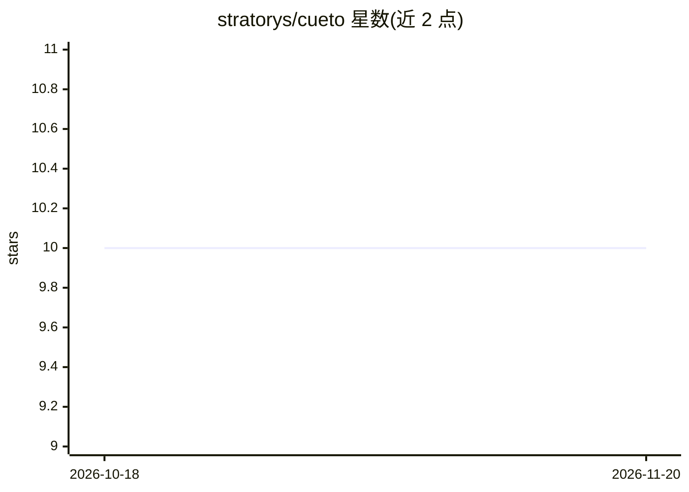

# stratorys/cueto

⭐ 10 · Go · MPL-2.0 · 推送 2026-08-17 · [GitHub](https://github.com/stratorys/cueto) · [官网](https://stratorys.com) · 个人维护

**以 CUE 数据为唯一事实源的图表编辑与求值服务器**

cueto 将组织事实（团队、服务、归属、依赖）收敛为单一 CUE 值，从纯 schema 与数据推断图表，提供 Web 可视化编辑器（Vue + Vue Flow）与 REPL，画布与代码通过 source map 双向同步，保存写入真实文件并以 git 记录历史。悬空引用在构建期报错而非产生陈旧数据。提供 `cueto serve` 单二进制运行方式，以及面向 CI 与 agent 的 CLI（catalog/query/eval/vet/check/graph 等）与 HTTP 端点，agent 只能调用受限的具名操作。声明为进行中、尚未可用于生产。

## 筛选速览

| 维度 | 判定 | 备注 |
|---|---|---|
| AI 角色 | `ai-enhanced` | 去掉 AI 部分产品仍成立 |
| 许可风险 | `permissive` | MPL-2.0 |
| 部署形态 | `library` | 以包/库形式分发 |
| 模型依赖 | — | README 未给出锁定关系 |
| 硬件要求 | — | 无带数字的原话,不猜 |
| 安装摩擦 | `low` | 无编译、无系统依赖或容器化 |
| 成熟度 | `idea` | |

## 能力要点

- 从纯 schema 与数据自动推断图与 ER/实例双视图，含检测规则溯源
- 悬空引用使构建失败，知识不会静默陈旧
- 单二进制内嵌 API、Web UI、schema 与示例
- CLI 与 HTTP 提供具名、受限的求值操作，供 CI 与 agent 调用

## 适用场景

- 以代码方式维护服务目录并可视化组织依赖关系
- 在 CI 中校验知识模块并执行具名求值
- 让 agent 通过受限端点获取精确、有 schema 保障的事实

## 场景标签

`知识图谱` · 领域:知识与检索

## 证据(README 行号)

> L6: An evaluation server for diagrams whose single source of truth is CUE. The same value is inferred as a diagram from 
> L110: The `cueto` CLI runs the same engine without the server, for CI and agents. Run it from `backend/`.
> L149: `vet`, `check`, `graph`, `describe`, `get` round out the set (`go run ./cmd/cueto help`). The same operations are 

## 星数曲线

2026-10-18 10 → 2026-11-20 10（+0）

---
*卡片 v1 · prompt 1.4 · 生成 2026-11-19 · 置信度 mid · 依据 README sha `c5a10644da1e` · [字段定义](../../DATASET.md)*
