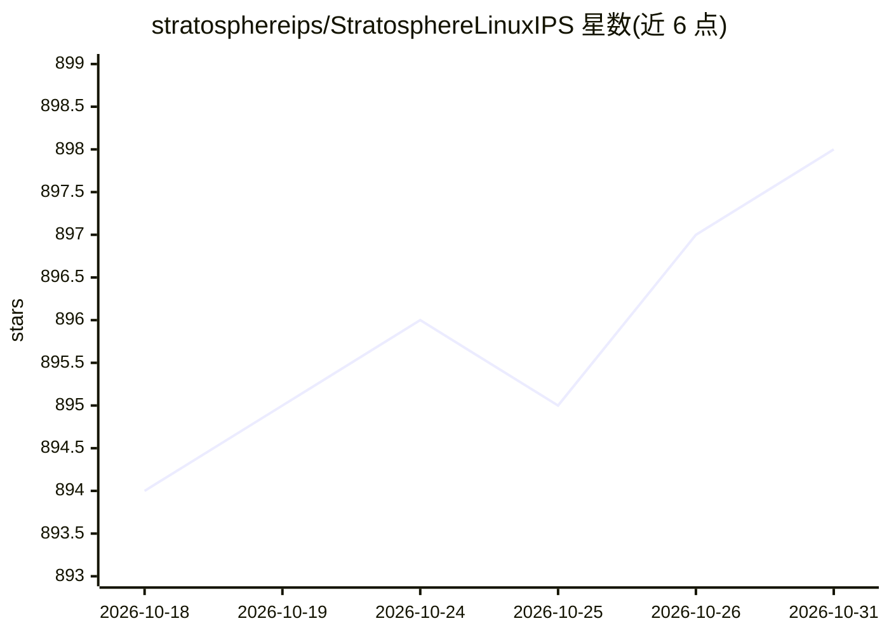

# stratosphereips/StratosphereLinuxIPS

⭐ 898 · Python · GPL-2.0 · 推送 2026-10-30 · [GitHub](https://github.com/stratosphereips/StratosphereLinuxIPS) · 组织维护

**基于机器学习的行为式网络入侵检测/防御系统（IDS/IPS）**

由捷克技术大学 Stratosphere 实验室（2012 年起）开发的 Python 行为式 IDS/IPS：用机器学习模型、40+ 威胁情报源与专家启发式规则分析网络流量，累积恶意证据达到阈值后告警。支持实时流量、PCAP 文件及 Suricata/Zeek/Argus 流；依赖 Zeek 捕获流量与 Redis 做进程间通信。支持 Linux/macOS/Windows（仅 Docker），阻断功能仅限 Linux，需 4GB 以上内存、Python 3.12.3，推荐 Docker 运行。

## 筛选速览

| 维度 | 判定 | 备注 |
|---|---|---|
| AI 角色 | `ai-native` | 本体是模型或模型工具 |
| 许可风险 | `viral` | GPL-2.0 |
| 部署形态 | `self-host` | docker 或自建部署 |
| 模型依赖 | local-ok | 支持本地模型 |
| 硬件要求 | — | 无带数字的原话,不猜 |
| 安装摩擦 | `low` | 无编译、无系统依赖或容器化 |
| 成熟度 | — | 结构信号不足 |

## 能力要点

- ML 模型 + 40+ 威胁情报源 + 专家启发式的证据累积告警机制
- 支持实时流量、PCAP、Suricata/Zeek/Argus 网络流输入
- 本地 Web 界面展示告警、证据与模块健康状态
- P2P 节点间 IoC 共享与免疫式 T 细胞响应模块

## 适用场景

- 在 Linux 端点上部署本地入侵检测与阻断
- 离线分析 PCAP 数据集排查恶意行为
- 检测定向攻击与 C2 通道并向分析师输出事件摘要

## 场景标签

`网络安全` · 领域:学习与行业

## 证据(README 行号)

> L30: # Slips: Behavioral Machine Learning-Based Intrusion Prevention System
> L32: Slips is a powerful endpoint behavioral intrusion prevention and detection system that uses machine learning to det
> L35: Slips is the first free software behavioral machine learning-based IDS/IPS for endpoints. It was created in 2012 by

## 星数曲线

2026-10-18 894 → 2026-10-31 898（+4）

---
*卡片 v1 · prompt 1.4 · 生成 2026-10-21 · 置信度 high · 依据 README sha `b918cd272f21` · [字段定义](../../DATASET.md)*
