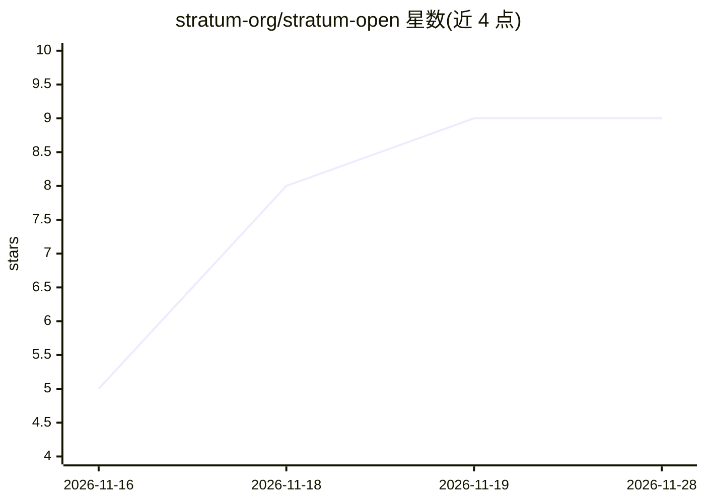

# stratum-org/stratum-open

⭐ 9 · Python · AGPL-3.0 · 推送 2026-11-24 · [GitHub](https://github.com/stratum-org/stratum-open) · 组织维护

**为开源维护者提供自托管小模型的 PR 审查与分诊工具**

面向开源维护者的 PR 审查与分诊工具，以 GitHub Action 形式运行在自有硬件或 GitHub 免费 runner 上，不外发数据、无需 API key。机制包括：无需模型的静态检查（密钥泄露、危险 workflow 变更、不存在的包名等）、本地 7-20B 开源模型生成审查摘要与行内修改建议、按 PR 打分诊标签并生成按审查成本排序的队列。规则通过仓库内 policy.yml 配置。GitHub 免费 runner 无 GPU，单次审查约数分钟。

## 筛选速览

| 维度 | 判定 | 备注 |
|---|---|---|
| AI 角色 | `ai-native` | 本体是模型或模型工具 |
| 许可风险 | `viral` | AGPL-3.0 |
| 部署形态 | `self-host` | docker 或自建部署 |
| 模型依赖 | local-ok | 支持本地模型 |
| 硬件要求 | — | 无带数字的原话,不猜 |
| 安装摩擦 | `low` | 无编译、无系统依赖或容器化 |
| 成熟度 | `idea` | |

## 能力要点

- 无需模型的检查捕获密钥、危险 workflow 变更与不存在的包名
- 本地运行 7-20B 开源模型生成审查与行内建议，数据不外发
- 每 PR 一个分诊标签及按审查成本排序的 PR 队列 issue
- 规则集中在仓库内 policy.yml，从默认分支读取

## 适用场景

- 在 GitHub Actions 中自动初审每个 PR 并排序审查队列
- 给 PR 打 ready/needs work 等分诊标签并给出理由
- 静态检查捕获贡献者 PR 中的密钥与可疑依赖

## 场景标签

`代码审查` · 领域:编码与开发

## 证据(README 行号)

> L17: them generated. Stratum Open reads each PR first and sorts the queue, so you
> L18: spend your review time on the ones worth it. It runs on open models of 7 to
> L22: - **It finds bugs, and it shows its numbers.** Of 39 real PRs, each with one bug planted, the example workflow foun

## 星数曲线

2026-11-16 5 → 2026-11-28 9（+4）

---
*卡片 v1 · prompt 1.4 · 生成 2026-11-20 · 置信度 high · 依据 README sha `fe8fca2f3f0f` · [字段定义](../../DATASET.md)*
