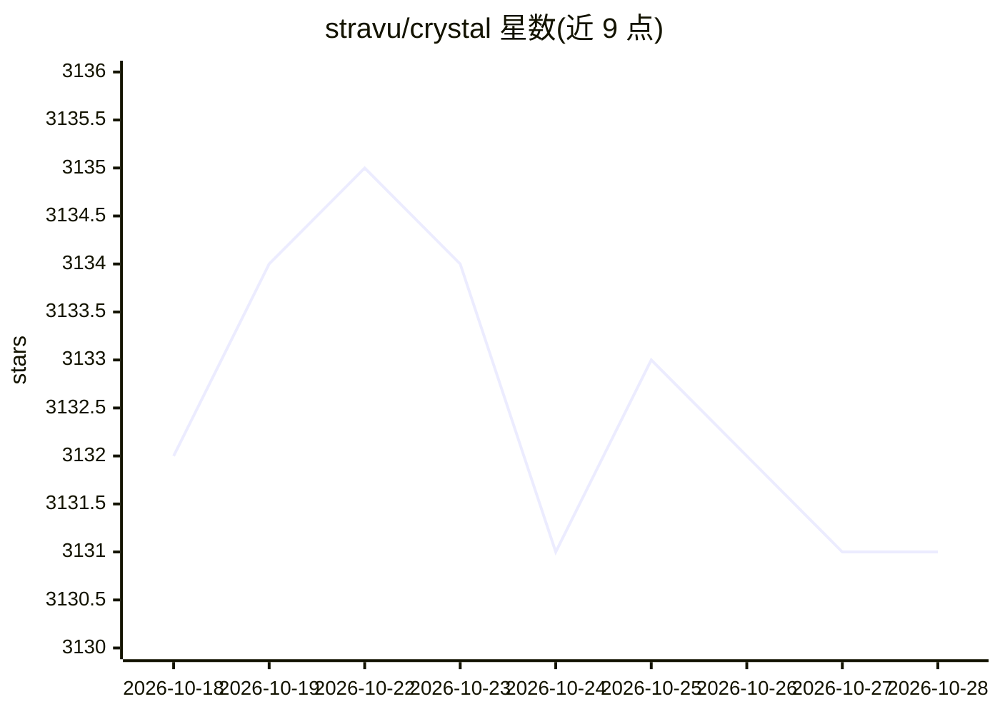

# stravu/crystal

⭐ 3,130 · TypeScript · MIT · 推送 2026-02-26 · [GitHub](https://github.com/stravu/crystal) · [官网](https://nimbalyst.com/) · 个人维护

**已弃用：在并行 git worktree 中管理多个 AI 编码会话的桌面应用**

Crystal 是一个桌面应用（Electron 构建），用于在多个 git worktree 中并行运行 Codex 与 Claude Code 会话，支持测试与比较不同 AI 方案、管理 AI 辅助开发工作流。项目已于 2026 年 2 月弃用，由后继产品 Nimbalyst 替代；README 明确建议迁移，Nimbalyst 提供 AI 原生工作区、多编辑器环境、worktree 隔离的并行 AI 编码会话与项目级会话跟踪等功能。下载入口指向 nimbalyst.com。

## 筛选速览

| 维度 | 判定 | 备注 |
|---|---|---|
| AI 角色 | `ai-ecosystem` | LLM/agent 周边工具 |
| 许可风险 | `permissive` | MIT |
| 部署形态 | `None` |  |
| 模型依赖 | — | README 未给出锁定关系 |
| 硬件要求 | — | 无带数字的原话,不猜 |
| 安装摩擦 | `low` | 无编译、无系统依赖或容器化 |
| 成熟度 | — | 结构信号不足 |

## 能力要点

- 在并行 git worktree 中运行多个 Codex / Claude Code 会话
- 测试、比较不同 AI 方案并管理 AI 辅助开发工作流
- 以 Electron 桌面应用形式提供（现已弃用，由 Nimbalyst 替代）

## 适用场景

- 并行开展多个 AI 编码会话并互相隔离
- 比较不同 AI 助手在相同代码任务上的方案

## 场景标签

 · 领域:开发工具/AI 编码

## 证据(README 行号)

> L10:  Crystal (formerly a multi-session AI code assistant manager) has been deprecated and replaced by Nimbalyst .
> L41: - Built on production-grade desktop foundations with Electron

## 星数曲线

2026-10-18 3,132 → 2026-10-28 3,131（-1）

---
*卡片 v1 · prompt 1.4 · 生成 2026-10-20 · 置信度 mid · 依据 README sha `49baf8fa61e8` · [字段定义](../../DATASET.md)*
