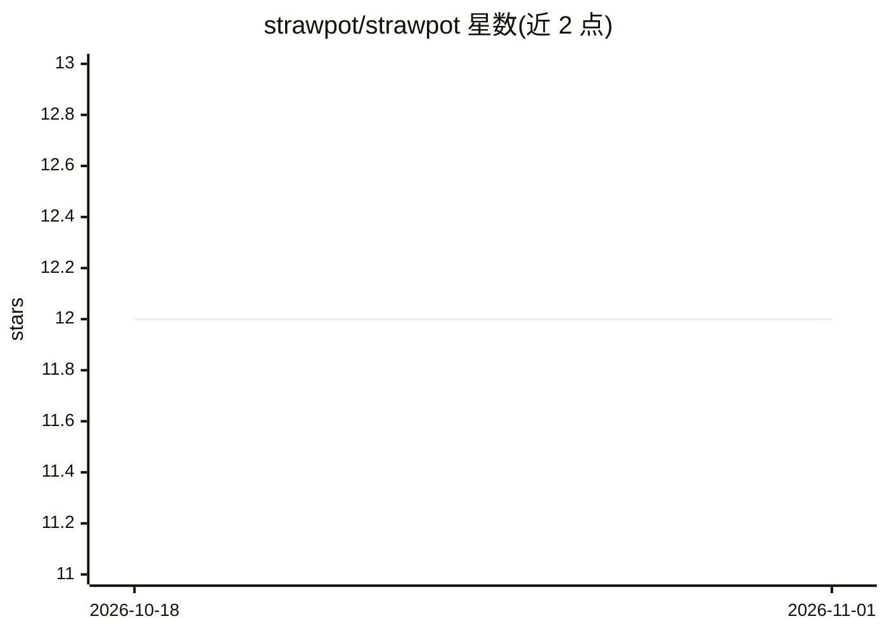

# strawpot/strawpot

⭐ 12 · Python · MIT · 推送 2026-04-10 · [GitHub](https://github.com/strawpot/strawpot) · [官网](https://strawpot.com) · 个人维护

**CLI 多 agent 编排器：角色化 AI 协作完成开发任务**

以角色（CEO/PM/实现者/审查者）为核心的层级多 agent 编排系统：agent 动态组合角色完成任务，无固定流水线；支持并发执行、跨会话三级记忆、git worktree 隔离、cron 定时任务与 JSONL 全链路追踪。运行时与 agent 无关，可在同一会话混用 Claude Code、Codex、Gemini CLI、OpenHands 等。角色与技能以 Markdown 文件定义，通过 StrawHub 注册表共享复用。README 明确声明输出非完全可靠、非确定性、尚非自主。

## 筛选速览

| 维度 | 判定 | 备注 |
|---|---|---|
| AI 角色 | `ai-ecosystem` | LLM/agent 周边工具 |
| 许可风险 | `permissive` | MIT |
| 部署形态 | `library` | 以包/库形式分发 |
| 模型依赖 | — | README 未给出锁定关系 |
| 硬件要求 | — | 无带数字的原话,不猜 |
| 安装摩擦 | `low` | 无编译、无系统依赖或容器化 |
| 成熟度 | `idea` | |

## 能力要点

- 层级多 agent 委派，策略控制深度/超时/缓存，JSONL 全链路追踪
- 运行时无关：同一会话按角色混用 Claude Code/Codex/Gemini/OpenHands 等
- 三级上下文卡片记忆，跨会话与项目持久化
- 角色与技能为 Markdown 文件，经 StrawHub 一条命令安装共享

## 适用场景

- 让一组 AI 角色从想法自动产出 PR（含实现、审查、QA）
- 自动分类与规划 GitHub issue 并拆解为子任务
- 定时让 agent 在夜间处理项目任务

## 场景标签

`多智能体` `编码 Agent` · 领域:Agent 开发

## 证据(README 行号)

> L104: **Hierarchical multi-agent delegation**
> L111: **Agent-agnostic runtime**

## 星数曲线

2026-10-18 12 → 2026-11-01 12（+0）

---
*卡片 v1 · prompt 1.4 · 生成 2026-10-31 · 置信度 high · 依据 README sha `8060eb339b1f` · [字段定义](../../DATASET.md)*
