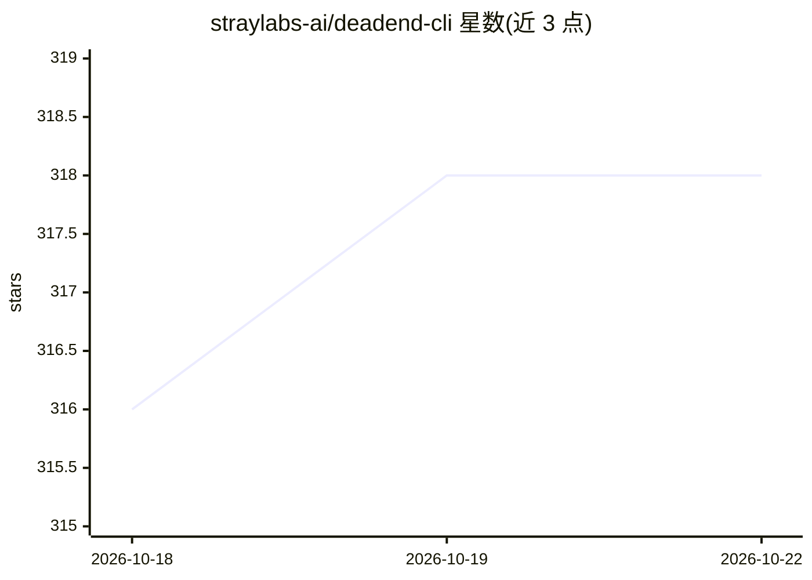

# straylabs-ai/deadend-cli

⭐ 318 · Python · AGPL-3.0 · 推送 2026-08-07 · [GitHub](https://github.com/straylabs-ai/deadend-cli) · 组织维护

**自主 Web 渗透测试 agent：反馈驱动迭代生成漏洞利用 payload**

面向安全测试人员的自主 Web 应用渗透测试 CLI：采用侦察→利用两阶段流程与 supervisor-subagent 架构，当标准工具失效时生成自定义 Python payload，观察响应并迭代改进直至突破；包含污点分析、源/汇点检测、认证处理与置信度决策机制。通过 LiteLLM 抽象层支持任意兼容 provider（Kimi、Claude、Ollama 等），本地执行，XBOW 104 题验证集上 Kimi K2.5 约 80%。需 Docker，Linux x86_64 / macOS ARM64 提供预编译二进制，处于活跃开发中。

## 筛选速览

| 维度 | 判定 | 备注 |
|---|---|---|
| AI 角色 | `ai-native` | 本体是模型或模型工具 |
| 许可风险 | `viral` | AGPL-3.0 |
| 部署形态 | `self-host` | docker 或自建部署 |
| 模型依赖 | local-ok | 支持本地模型 |
| 硬件要求 | — | 无带数字的原话,不猜 |
| 安装摩擦 | `low` | 无编译、无系统依赖或容器化 |
| 成熟度 | `idea` | |

## 能力要点

- 反馈驱动迭代：工具失败时生成自定义 Python payload 并根据响应精化
- 通过 LiteLLM 抽象层支持多家 LLM provider，含本地 Ollama
- 本地执行、沙箱化工具（Playwright、Docker、WebAssembly）
- XBOW 104 题验证集黑盒模式约 80%（Kimi K2.5，约 122 美元 API 成本）

## 适用场景

- 对自建 Web 应用自动化开展 SQL 注入、XSS、IDOR 等漏洞测试
- 授权渗透测试中自动化生成与验证定制 payload
- 在 API 端点上做认证与访问控制安全测试

## 场景标签

 · 领域:网络安全/渗透测试

## 证据(README 行号)

> L35: Deadend CLI is an autonomous web application penetration testing agent that uses feedback-driven iteration to adapt
> L39: - Model-agnostic design (works with any deployable LLM)
> L262: Deadend CLI uses LiteLLM for model abstraction, which provides a unified interface to multiple LLM providers. Mode

## 星数曲线

2026-10-18 316 → 2026-10-22 318（+2）

---
*卡片 v1 · prompt 1.4 · 生成 2026-10-22 · 置信度 mid · 依据 README sha `1c4632f76ac6` · [字段定义](../../DATASET.md)*
