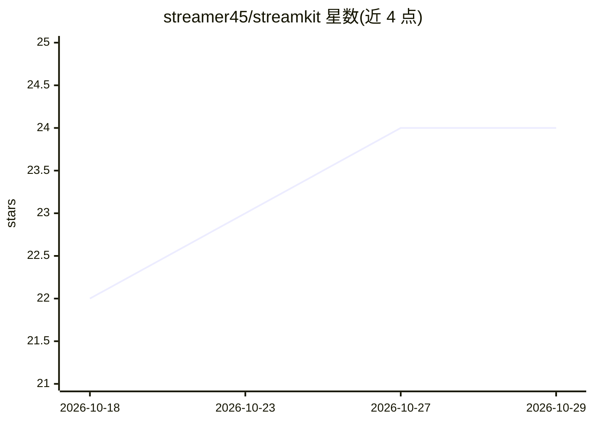

# streamer45/streamkit

⭐ 24 · Rust · MPL-2.0 · 推送 2026-09-19 · [GitHub](https://github.com/streamer45/streamkit) · [官网](http://streamkit.dev) · 个人维护

**自托管实时媒体处理引擎：节点图构建视频合成与语音管道**

用 Rust 编写的自托管媒体处理服务器，以单一二进制 skit 运行，通过 Web UI、YAML 或 API 将流水线组织为节点图（DAG）。提供两种模式：Dynamic 处理长时交互会话（语音代理、直播），Oneshot 处理无状态 HTTP 请求（批量转录、文件转换）。能力包括视频合成（CPU/GPU wgpu，VP9/AV1）、Servo 网页渲染入流、Whisper/SenseVoice 语音转写、Kokoro/Piper/Matcha 语音合成、NLLB/Helsinki 翻译。传输基于 MoQ/WebTransport（QUIC）。当前仅支持 Linux x86_64，项目自述处于早期阶段、未经生产强化，可能存在破坏性变更。

## 筛选速览

| 维度 | 判定 | 备注 |
|---|---|---|
| AI 角色 | `ai-native` | 本体是模型或模型工具 |
| 许可风险 | `permissive` | MPL-2.0 |
| 部署形态 | `self-host` | docker 或自建部署 |
| 模型依赖 | — | README 未给出锁定关系 |
| 硬件要求 | `cpu-ok` | |
| 安装摩擦 | `low` | 无编译、无系统依赖或容器化 |
| 成熟度 | `idea` | |

## 能力要点

- 节点图（DAG）流水线，支持 Web UI / YAML / API 三种定义方式
- Dynamic（实时可热调）与 Oneshot（无状态 HTTP）双执行模式
- 内置认证、Web UI 管道编辑器、skit-cli 命令行与 Grafana 监控样例
- 可选 ML 插件：Whisper/SenseVoice STT、Kokoro/Piper/Matcha TTS、NLLB/Helsinki 翻译

## 适用场景

- 搭建自托管直播视频合成与叠加层服务
- 构建语音代理或实时双语字幕流水线
- 通过 HTTP API 做批量转写与文件转换

## 场景标签

`语音合成` `语音识别` `图像视频处理` · 领域:内容生成

## 证据(README 行号)

> L18: **StreamKit** is a self-hostable media processing server (written in Rust). You run a single binary (`skit`), then 
> L47: - **Speech pipelines** — Build a transcription service: ingest audio via MoQ, run Whisper STT, stream transcription
> L48: - **Voice agents** — TTS-powered bots that respond to audio input with Kokoro, Piper, or Matcha.

## 星数曲线

2026-10-18 22 → 2026-10-29 24（+2）

---
*卡片 v1 · prompt 1.4 · 生成 2026-10-27 · 置信度 high · 依据 README sha `a3bda4e04f4b` · [字段定义](../../DATASET.md)*
