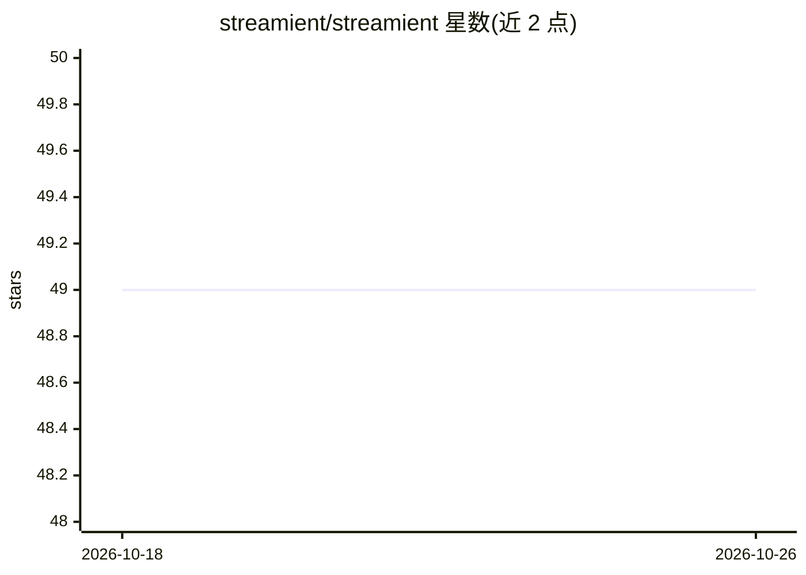

# streamient/streamient

⭐ 49 · JavaScript · AGPL-3.0 · 推送 2026-10-24 · [GitHub](https://github.com/streamient/streamient) · [官网](https://streamient.com) · 组织维护

**面向团队的 AI 记忆层：把分散知识变为 MCP 工具可用的上下文**

开源记忆基础设施：集中存储笔记、短记忆、URL 与知识图谱关系，通过内置 MCP Server（44 个工具、stdio/SSE/Streamable HTTP 三种传输）让 Claude Desktop、Cursor 等 MCP 客户端跨会话共享检索同一上下文。附带 CLI、浏览器扩展、Obsidian 双向同步与 Git 双向同步，支持全文与语义搜索及 AI Chat。提供托管云版与自托管版（功能相同），自托管通过 Docker Compose 部署，依赖 Node.js 24+、MongoDB、Memcached、Typesense。AGPL-3.0 许可。

## 筛选速览

| 维度 | 判定 | 备注 |
|---|---|---|
| AI 角色 | `ai-ecosystem` | LLM/agent 周边工具 |
| 许可风险 | `viral` | AGPL-3.0 |
| 部署形态 | `self-host` | docker 或自建部署 |
| 模型依赖 | — | README 未给出锁定关系 |
| 硬件要求 | — | 无带数字的原话,不猜 |
| 安装摩擦 | `low` | 无编译、无系统依赖或容器化 |
| 成熟度 | — | 结构信号不足 |

## 能力要点

- 内置 MCP Server：44 个工具，覆盖笔记/记忆/URL/项目/图谱/搜索
- Obsidian 双向同步与 Git 双向同步
- 全文与语义搜索（Typesense），知识图谱支持手动/标签/语义链接
- 云版与自托管版功能一致，自托管免费开源

## 适用场景

- 让团队的多个 AI 工具共享同一份可检视的记忆库
- 把公司文档、决策和链接整理为 AI 可检索的项目上下文
- 自托管部署，掌控团队知识的存储与备份

## 场景标签

`Agent 记忆` `知识库管理` `知识图谱` · 领域:Agent 开发

## 证据(README 行号)

> L12: Streamient is an open-source memory layer for AI-native teams and MCP-compatible tools. Store notes, memories, URLs
> L36: - **MCP Server** — 44 tools for notes, memories, URLs, projects, graph, and search
> L161: - **Shared memory across tools** so Claude Desktop, Cursor, and others pull from the same context

## 星数曲线

2026-10-18 49 → 2026-10-26 49（+0）

---
*卡片 v1 · prompt 1.4 · 生成 2026-10-24 · 置信度 high · 依据 README sha `639c14d3a118` · [字段定义](../../DATASET.md)*
