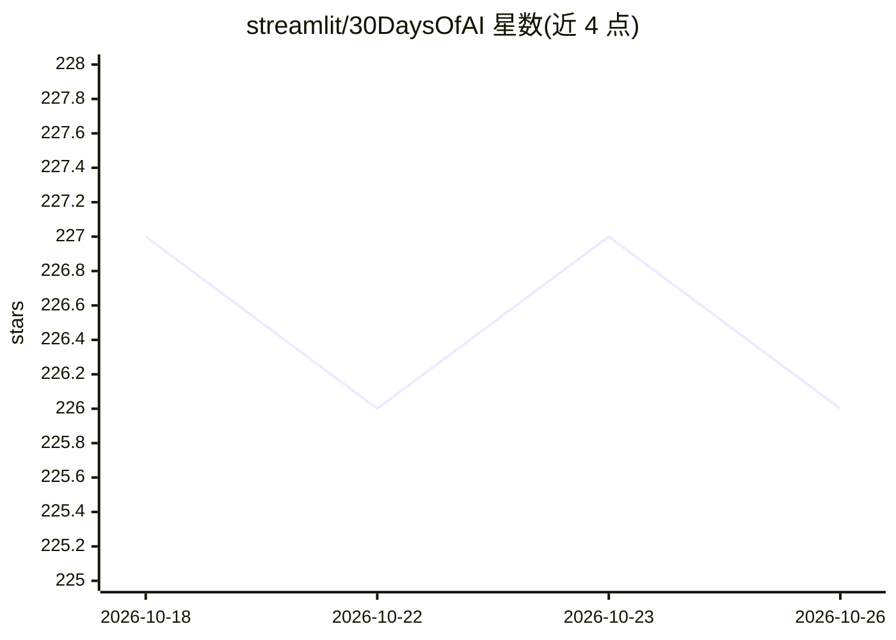

# streamlit/30DaysOfAI

⭐ 226 · Python · Apache-2.0 · 推送 2026-02-19 · [GitHub](https://github.com/streamlit/30DaysOfAI) · [官网](https://30daysofai.streamlit.app/) · 组织维护

**30 天学建 AI 应用的 Streamlit/Snowflake 教程挑战**

由 Streamlit 维护的 30 天学习挑战仓库：每天提供一个可运行的 Streamlit 应用文件（day1.py-day30.py）与配套课程文档（day1.md-day30.md），教学内容覆盖聊天机器人、RAG 系统与智能体开发，技术栈基于 Snowflake Cortex AI（Cortex Search/Analyst/Agents）与 TruLens。本地运行需 Python 3.11/3.12、安装依赖并配置 Snowflake 连接密钥，也可在 Snowsight 中直接运行；需 Snowflake 免费试用账号。

## 筛选速览

| 维度 | 判定 | 备注 |
|---|---|---|
| AI 角色 | `ai-knowledge` | 知识聚合/清单类 |
| 许可风险 | `permissive` | Apache-2.0 |
| 部署形态 | `library` | 以包/库形式分发 |
| 模型依赖 | — | README 未给出锁定关系 |
| 硬件要求 | — | 无带数字的原话,不猜 |
| 安装摩擦 | `low` | 无编译、无系统依赖或容器化 |
| 成熟度 | — | 结构信号不足 |

## 能力要点

- 每日提供完整可运行的 Streamlit 应用代码与分步文档
- 技术栈：Streamlit + Snowflake Cortex AI（Search/Analyst/Agents）+ TruLens
- 支持本地运行与 Snowflake Snowsight 两种运行方式
- 完成 30 天挑战可进入 Hall of Fame

## 适用场景

- 跟着 30 天教程系统学习构建 AI 应用
- 获取聊天机器人、RAG、智能体的可运行示例代码
- 学习在 Snowflake 上部署 Streamlit AI 应用

## 场景标签

`教程课程` · 领域:学习与行业

## 证据(README 行号)

> L3: Welcome to **#30DaysOfAI** — a comprehensive 30-day challenge to learn, build, and deploy AI-powered applications us
> L91: Each day includes:

## 星数曲线

2026-10-18 227 → 2026-10-26 226（-1）

---
*卡片 v1 · prompt 1.4 · 生成 2026-10-22 · 置信度 high · 依据 README sha `1a5058eb940d` · [字段定义](../../DATASET.md)*
