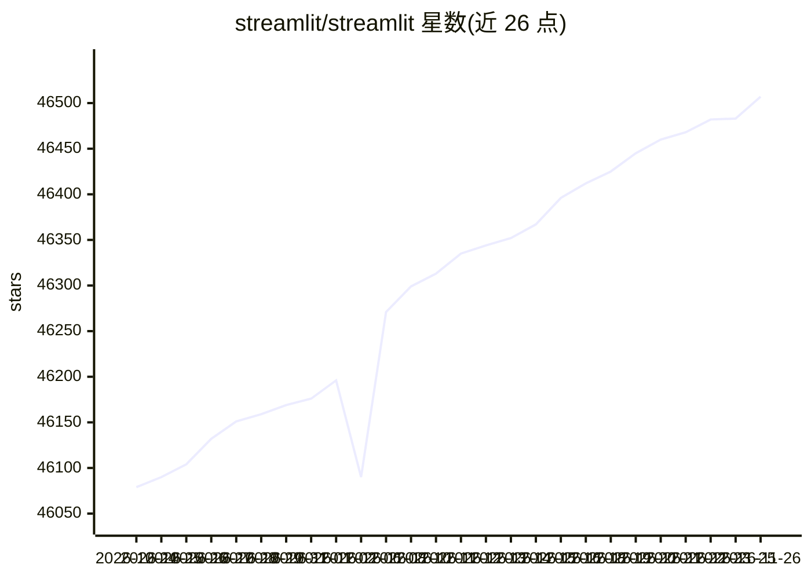

# streamlit/streamlit

⭐ 46,507 · Python · Apache-2.0 · 推送 2026-11-25 · [GitHub](https://github.com/streamlit/streamlit) · [官网](https://streamlit.io) · 组织维护

**用纯 Python 构建数据应用与仪表盘的应用框架**

Python 编写的数据应用框架：应用即纯 Python 脚本，无需单独前端或 API 层，框架负责界面、状态、缓存、登录、主题等。定位为 agent 可编写的应用层，提供 `streamlit skills` 为 Claude Code 等编码 agent 安装技能包；应用可经 MCP 被 Claude/ChatGPT/Cursor 等客户端当作工具调用。提供 pip 安装、三个示例应用源码与 Community Cloud 免费部署。已暂停接受外部维护者团队之外的 pull request。

## 筛选速览

| 维度 | 判定 | 备注 |
|---|---|---|
| AI 角色 | `ai-ecosystem` | LLM/agent 周边工具 |
| 许可风险 | `permissive` | Apache-2.0 |
| 部署形态 | `library` | 以包/库形式分发 |
| 模型依赖 | — | README 未给出锁定关系 |
| 硬件要求 | — | 无带数字的原话,不猜 |
| 安装摩擦 | `low` | 无编译、无系统依赖或容器化 |
| 成熟度 | — | 结构信号不足 |

## 动量与使用信号

- 维护:`active` — 距上次 push 0.8 天,年发版 22,319 位贡献者
- 涨星:近 1 天 **+15**(自 20261016 起算)
- 安装:pypi 包 `streamlit` 月下载 19,368,322

## 能力要点

- 纯 Python 单层应用，框架内置状态、缓存、登录（st.login）与主题
- `streamlit skills` 为 Claude Code 等编码 agent 安装版本匹配的技能包
- 应用可作 MCP 工具被 Claude/ChatGPT/Cursor 调用，无需另建 API
- @st.fragment 局部重跑与后台缓存刷新、URL 查询参数绑定筛选

## 适用场景

- 搭建营收、运营等 KPI 仪表盘并从 BI 工具迁移
- 构建带 what-if 参数的预测与情景模拟应用
- 做审批、签核、数据质量分流的内部工作流应用
- 让编码 agent 按最佳实践生成和迭代数据应用

## 场景标签

 · 领域:开发者工具/数据应用

## 证据(README 行号)

> L7: **Streamlit is the agent-native data app framework.** Use it for dashboards, forecasting
> L54: Streamlit is also great for AI chat and agent apps
> L117: - **Built for agents.** Agents drive the running app without a browser, read the numbers

## 星数曲线

2026-10-24 46,079 → 2026-11-26 46,507（+428）

---
*卡片 v1 · prompt 1.4 · 生成 2026-11-22 · 置信度 high · 依据 README sha `35bb4daf6f11` · [字段定义](../../DATASET.md)*
