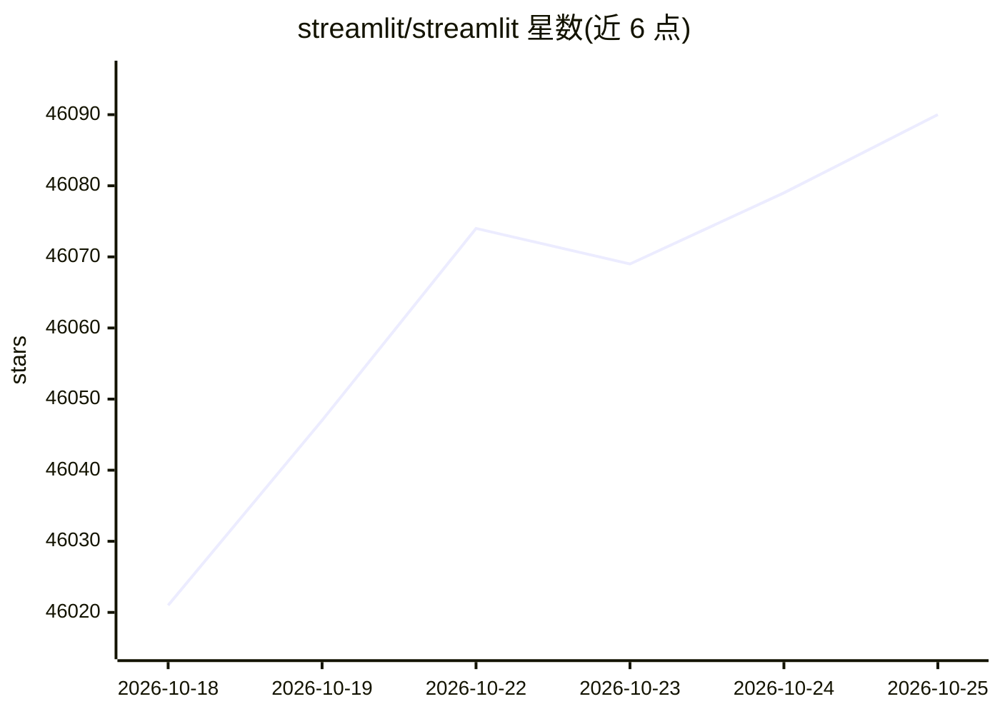

# streamlit/streamlit

⭐ 46,104 · Python · Apache-2.0 · 推送 2026-10-25 · [GitHub](https://github.com/streamlit/streamlit) · [官网](https://streamlit.io) · 组织维护

**让开发者用 Python 脚本快速构建和分享数据应用**

Streamlit 将 Python 脚本转换为交互式 Web 应用的框架：提供输入组件、数据框、图表、布局与多页面应用等元素，编辑脚本后应用即时更新。应用可通过 Streamlit Community Cloud 平台免费部署、管理和分享。通过 pip 安装，社区可通过 Streamlit Components 扩展功能；目前 README 注明已暂停接受维护者团队之外的 pull request。

## 筛选速览

| 维度 | 判定 | 备注 |
|---|---|---|
| AI 角色 | `ai-ecosystem` | LLM/agent 周边工具 |
| 许可风险 | `permissive` | Apache-2.0 |
| 部署形态 | `library` | 以包/库形式分发 |
| 模型依赖 | — | README 未给出锁定关系 |
| 硬件要求 | — | 无带数字的原话,不猜 |
| 安装摩擦 | `low` | 无编译、无系统依赖或容器化 |
| 成熟度 | — | 结构信号不足 |

## 动量与使用信号

- 维护:`active` — 距上次 push 0.8 天,年发版 22,319 位贡献者
- 涨星:近 1 天 **+15**(自 20261016 起算)
- 安装:pypi 包 `streamlit` 月下载 19,368,322

## 能力要点

- 将 Python 脚本转换为交互式 Web 应用（仪表盘、报告、聊天应用）
- 实时编辑：脚本修改后应用即时更新
- Community Cloud 平台免费部署、管理和分享应用
- 支持通过 Streamlit Components 扩展能力

## 适用场景

- 快速搭建数据仪表盘和可视化报告
- 创建 LLM 与聊天机器人应用界面
- 构建科研或金融领域的交互式数据应用
- 在 Community Cloud 上部署分享数据应用

## 场景标签

 · 领域:开发者工具/数据应用

## 证据(README 行号)

> L9: Streamlit lets you transform Python scripts into interactive web apps in minutes, instead of weeks. Build dashboards
> L92: - 🤖 LLMs & chatbot apps
> L103: Deploy, manage and share your apps for free using our Community Cloud! Sign-up here.

## 星数曲线

2026-10-18 46,021 → 2026-10-25 46,090（+69）

---
*卡片 v1 · prompt 1.4 · 生成 2026-10-18 · 置信度 high · 依据 README sha `c3e0fad52d2d` · [字段定义](../../DATASET.md)*
