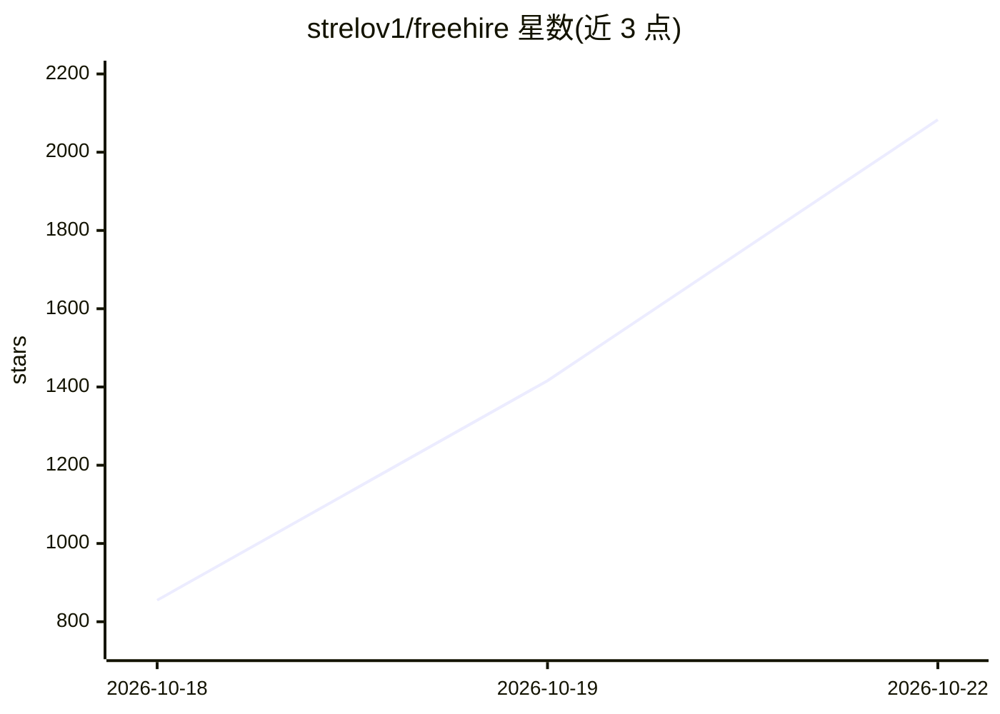

# strelov1/freehire

⭐ 2,776 · Go · MIT · 推送 2026-10-22 · [GitHub](https://github.com/strelov1/freehire) · [官网](https://freehire.me) · 个人维护

**开源 IT 职位聚合搜索引擎：直连 3.3M+ 公司招聘页的职位目录**

用 Go 编写的开源职位搜索引擎：从 225 个来源（92 个 ATS 平台、聚合器与公司招聘页）爬取 330 万+ 在招职位，归一化为单一 schema 并按键去重，提供分面全文搜索（地区/工作方式/资历/技能/薪资）、公开无密钥 HTTP API 与 CLI。上层建 CV 构建与 ATS 打分、申请跟踪、Chrome 扩展等求职工具；LLM 功能（AI 匹配分析、CV 定制、内置 agent）通过任意 OpenAI 兼容端点接入，未配置时相应功能禁用，目录本身不依赖 LLM。Docker Compose 一键启动全栈（PostgreSQL+pgvector、Meilisearch、Redis、S3），MIT 许可、可自托管。

## 筛选速览

| 维度 | 判定 | 备注 |
|---|---|---|
| AI 角色 | `ai-enhanced` | 去掉 AI 部分产品仍成立 |
| 许可风险 | `permissive` | MIT |
| 部署形态 | `self-host` | docker 或自建部署 |
| 模型依赖 | — | README 未给出锁定关系 |
| 硬件要求 | — | 无带数字的原话,不猜 |
| 安装摩擦 | `low` | 无编译、无系统依赖或容器化 |
| 成熟度 | — | 结构信号不足 |

## 能力要点

- 3.3M+ 职位来自 225 个来源（92 个 ATS 平台），单一 schema 去重
- 公开无密钥 HTTP API + CLI + MCP server + Chrome 扩展
- 新增公司只需 boards 目录一行记录，新增 ATS 平台为新增 adapter
- Docker Compose 一键启动全栈；LLM 功能按需配置 OpenAI 兼容端点

## 适用场景

- 一站式搜索直连公司招聘页的 IT 职位，避开招聘中介转帖与死链
- 自托管职位目录或用公开 API 在其上构建求职工具
- 用 AI 匹配分析与 CV 定制辅助投递，并跟踪申请进度

## 场景标签

 · 领域:招聘/求职工具

## 证据(README 行号)

> L45: Aggregating **3.3M+ live postings** from **294,000+ companies** across **92 ATS
> L60: |**Find**|Faceted search, curated collections, saved searches with email/Telegram digests, shared boards, market an
> L63: |**Ask**|An in-process agent with five presets — chat, browse, profile, CV tailoring, interview rehearsal — with no

## 星数曲线

2026-10-18 855 → 2026-10-22 2,083（+1,228）

---
*卡片 v1 · prompt 1.4 · 生成 2026-10-21 · 置信度 high · 依据 README sha `8d66659e4274` · [字段定义](../../DATASET.md)*
