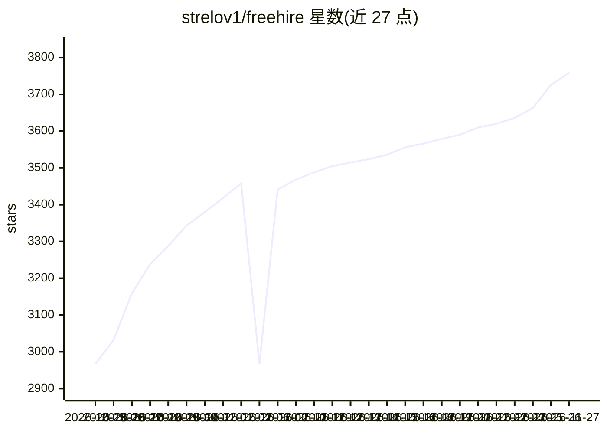

# strelov1/freehire

⭐ 3,759 · Go · MIT · 推送 2026-11-26 · [GitHub](https://github.com/strelov1/freehire) · [官网](https://freehire.me) · 个人维护

**面向求职者的开源职位搜索引擎：直采公司 ATS 的职位聚合与检索**

以 Go 编写的职位聚合与搜索系统，直接从 168 个 ATS 平台（Workday、Greenhouse、Lever 等）及聚合器、Telegram 频道共 437 个来源抓取职位，统一 schema 去重后经 Meilisearch 提供分面检索，并附公开 HTTP API、CLI 与 MCP server。除目录检索外，同一仓库还包含简历构建与打分、求职申请看板、收件箱、以及带五个预设的应用内 agent。Pro 订阅提供简历定制、表单填写扩展与自动投递。本地经 Docker Compose 一键启动整套服务。

## 筛选速览

| 维度 | 判定 | 备注 |
|---|---|---|
| AI 角色 | `ai-enhanced` | 去掉 AI 部分产品仍成立 |
| 许可风险 | `permissive` | MIT |
| 部署形态 | `self-host` | docker 或自建部署 |
| 模型依赖 | — | README 未给出锁定关系 |
| 硬件要求 | — | 无带数字的原话,不猜 |
| 安装摩擦 | `low` | 无编译、无系统依赖或容器化 |
| 成熟度 | — | 结构信号不足 |

## 能力要点

- 从 700,000+ 公司直采 4.9M+ 在招职位，去重后链接回原始发布页
- 分面全文搜索：地区、工作模式、资历、技能与薪资
- 提供无密钥公开 HTTP API、CLI、Telegram 摘要与 MCP server
- 内置简历构建、申请追踪看板与五个预设的应用内 agent

## 适用场景

- 自托管一套职位搜索引擎并基于其 API 做二次开发
- 按地区、远程模式、资历等条件检索公司官方在招职位
- 追踪投递进度并将招聘者回复关联到对应申请

## 场景标签

`网页抓取` · 领域:效率与自动化

## 证据(README 行号)

> L46: - **Search that understands jobs.** Faceted full-text search over region, work mode,
> L68: **Pro — $5/month** adds the AI that does the applying with you:
> L92: |**Ask**|An in-process agent with five presets — chat, browse, profile, CV tailoring, interview rehearsal — with no

## 星数曲线

2026-10-25 2,967 → 2026-11-27 3,759（+792）

---
*卡片 v1 · prompt 1.4 · 生成 2026-11-26 · 置信度 high · 依据 README sha `06009e8cd89c` · [字段定义](../../DATASET.md)*
