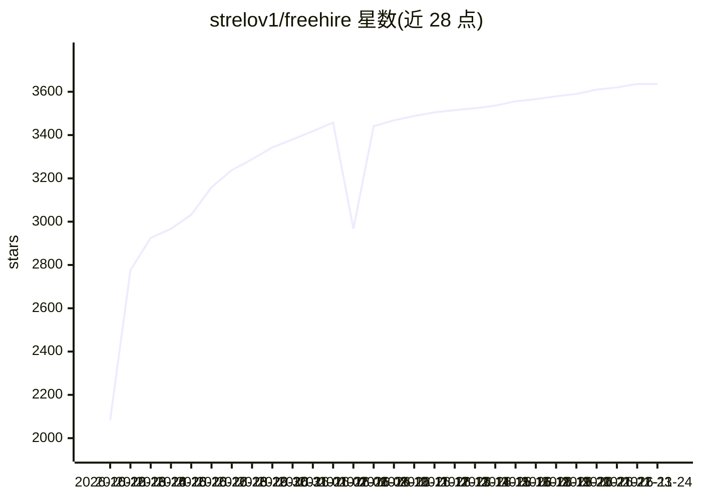

# strelov1/freehire

⭐ 3,636 · Go · MIT · 推送 2026-11-22 · [GitHub](https://github.com/strelov1/freehire) · [官网](https://freehire.me) · 个人维护

**求职者的开源招聘搜索引擎：直接抓取公司 ATS 的职位并支持 AI 辅助投递**

从公司自有的招聘系统（Workday、Greenhouse、Lever、Ashby、iCIMS 等 168 个 ATS 平台）直接抓取职位，归一化为单一 schema 并按稳定键去重，提供分面全文检索（地区、工作形式、资历、技能、薪资）。核心为 Go + Fiber 服务器、PostgreSQL/pgvector、Meilisearch，LLM 功能经 langchaingo 走任意 OpenAI 兼容端点，由 Bifrost 网关与 Langfuse 追踪支撑。抓取、富化、索引、通知皆为独立一次性 worker。提供免钥公开 HTTP API、CLI、MCP 服务器与浏览器扩展。托管版免费，Pro（$5/月）提供 CV 定制、自动投递等 AI 功能。

## 筛选速览

| 维度 | 判定 | 备注 |
|---|---|---|
| AI 角色 | `ai-enhanced` | 去掉 AI 部分产品仍成立 |
| 许可风险 | `permissive` | MIT |
| 部署形态 | `self-host` | docker 或自建部署 |
| 模型依赖 | — | README 未给出锁定关系 |
| 硬件要求 | — | 无带数字的原话,不猜 |
| 安装摩擦 | `low` | 无编译、无系统依赖或容器化 |
| 成熟度 | — | 结构信号不足 |

## 能力要点

- 从 437 个来源抓取 490 万+ 去重职位，直链原始公司招聘页
- 168 个 ATS 平台适配器，加入公司仅需在目录中添加一行
- 内置 agent 五种预设：聊天、浏览、档案、CV 定制、面试演练
- 提供免钥公开 HTTP API、CLI、MCP 服务器与表单填写浏览器扩展

## 适用场景

- 按地区、远程形式、资历分面筛选来自公司源头的职位
- 自托管整套职位抓取与检索管线并基于 API 构建
- 让 AI 定制简历并自动填写申请表单、跟踪投递进度

## 场景标签

`网页抓取` · 领域:效率与自动化

## 证据(README 行号)

> L46: - **Search that understands jobs.** Faceted full-text search over region, work mode,
> L90: |**Apply**|CV builder with ATS-safe PDF templates, deterministic CV↔vacancy scoring, AI fit analysis, CV tailoring 
> L100: - **Go** + Fiber v2 — HTTP server

## 星数曲线

2026-10-22 2,083 → 2026-11-24 3,636（+1,553）

---
*卡片 v1 · prompt 1.4 · 生成 2026-11-23 · 置信度 high · 依据 README sha `cd2b35b67e5f` · [字段定义](../../DATASET.md)*
